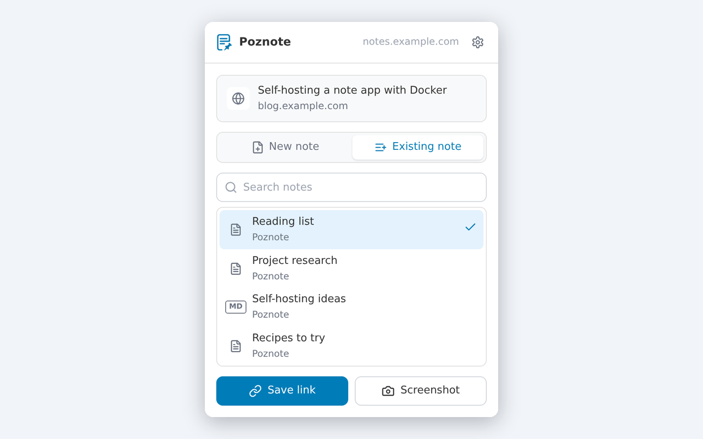

<!-- lang-selector -->

  <a href="CHROME-EXTENSION.md">English</a> ·
  <a href="CHROME-EXTENSION.fr.md">Français</a> ·
  <a href="CHROME-EXTENSION.de.md">Deutsch</a> ·
  <a href="CHROME-EXTENSION.es.md">Español</a> ·
  <a href="CHROME-EXTENSION.pt.md">Português</a> ·
  <a href="CHROME-EXTENSION.ru.md">Русский</a> ·
  <b>简体中文</b> ·
  <a href="CHROME-EXTENSION.ko.md">한국어</a> ·
  <a href="CHROME-EXTENSION.ja.md">日本語</a>

<!-- /lang-selector -->

# Poznote Chrome 扩展

**Poznote URL Saver** 是一个浏览器扩展，只需一次点击即可把当前页面保存到您的 Poznote 实例：保存页面地址，或保存地址及截图，可以存为新笔记，也可以追加到已有笔记的末尾。

  

直接从 Chrome 网上应用店安装该扩展：[安装扩展](https://chromewebstore.google.com/detail/bmjclfamahegmgillaghhmnbkjebipbh?utm_source=item-share-cb)

## 将扩展连接到您的实例

1. 在 Poznote 中打开 **设置 > 应用密码**，创建一个以该扩展命名的应用密码，并复制显示的密钥。密钥只显示一次。
2. 点击扩展图标，然后点击 **Connect**。扩展的设置页面会在新标签页中打开。
3. 填写 **Poznote address**（例如 `https://notes.example.com`）、您的 **Username** 和刚刚复制的 **App password**，然后点击 **Connect**，并在 Chrome 询问时允许扩展访问您的实例。
4. 选择新笔记要存放的 **Workspace**，以及可选的 **Folder**。选择会立即保存。

以后要修改这些设置，请点击扩展顶部的齿轮图标。

旁边显示的实例地址是一个链接：点击它即可在新标签页中打开 Poznote，并按照你在设置中填写的方式使用 http 或 https。

当 Chrome 的语言为英语、法语、德语、西班牙语、葡萄牙语、俄语、韩语、简体中文或日语时，扩展会使用该语言，否则使用英语。

这里也可以使用您的账户密码，但对于扩展来说，应用密码是更合适的凭据：它只能访问 API，永远无法进入网页界面或您的账户设置，仅限于您自己的资料，而且在 Poznote 中撤销它即可切断扩展的访问，不会影响其他任何东西。完整的限制列表请参阅[应用密码](README.zh-cn.md#应用密码)。

> **如果您的实例仅支持 SSO**，应用密码是连接扩展的唯一方式：扩展所需的登录表单对您的账户并不存在。请按照上述步骤，在 **设置 > 应用密码** 中创建一个。

## 保存页面

在想要保存的页面上点击扩展图标，然后选择保存位置：

- **New note** 以页面标题为名称创建一条笔记，存放在设置中选择的工作区和文件夹里。
- **Existing note** 把页面追加到您在列表中选择的笔记末尾。列表显示您最近的笔记，并会随输入实时搜索。列表只包含设置中所选工作区的笔记；打开 **All workspaces** 即可选择任意工作区中的笔记。扩展会记住这条笔记供下一个页面使用，因此把链接收集到同一个阅读清单里，每个页面只需点击一次。HTML 和 Markdown 笔记都可以接收页面。

然后点击 **Save link** 保存页面地址，或者点击 **Screenshot** 保存地址及其下方页面可见部分的截图。确认信息中有一个链接，可在 Poznote 中打开该笔记。
