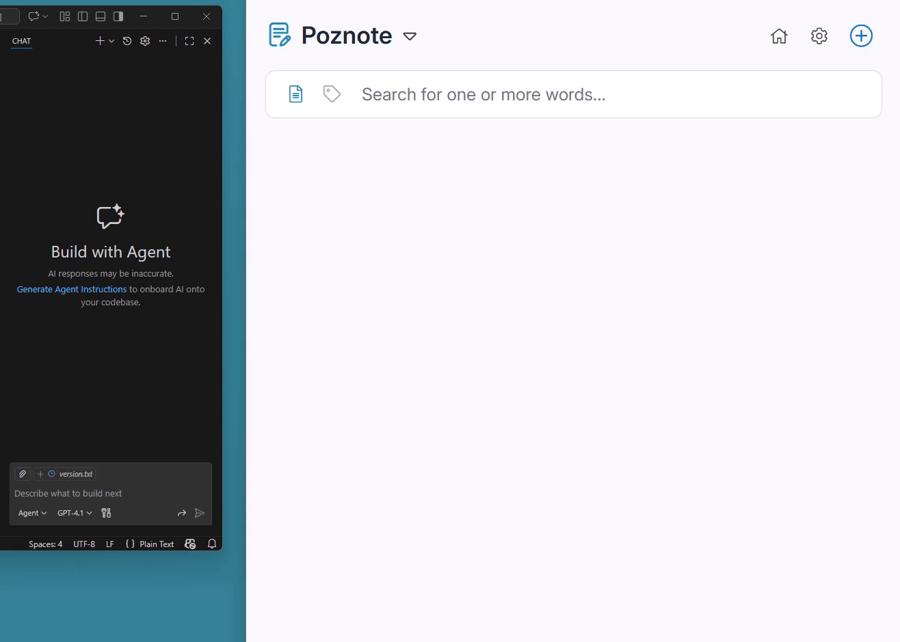

<!-- lang-selector -->
<p align="center">
  <a href="MCP-SERVER.md">English</a> ·
  <a href="MCP-SERVER.fr.md">Français</a> ·
  <b>Deutsch</b> ·
  <a href="MCP-SERVER.es.md">Español</a> ·
  <a href="MCP-SERVER.pt.md">Português</a> ·
  <a href="MCP-SERVER.ru.md">Русский</a> ·
  <a href="MCP-SERVER.zh-cn.md">简体中文</a> ·
  <a href="MCP-SERVER.ko.md">한국어</a>
</p>
<!-- /lang-selector -->

# Poznote MCP-Server

MCP-Server (Model Context Protocol) für Poznote: ermöglicht eine KI-gestützte Verwaltung Ihrer Notizen in natürlicher Sprache.

Dieser Server unterstützt **ausschließlich den HTTP-Transport** (MCP Streamable HTTP).

> [!TIP]
> Sie suchen einen Chat mit einem lokalen Modell (z. B. Ollama) direkt in Poznote? Dafür brauchen Sie den MCP-Server nicht, verwenden Sie stattdessen den integrierten [KI-Assistenten](AI-ASSISTANT.de.md) (**Einstellungen → Admin-Werkzeuge → KI-Assistent**). Der MCP-Server dient dazu, *externe* MCP-fähige Assistenten mit Ihren Notizen zu verbinden; Ollama allein ist eine Laufzeitumgebung für Modelle, kein MCP-Client, und kann sich nicht direkt mit ihm verbinden.

<p align="center">
  
</p>

## Schnellstart

Wählen Sie Ihren bevorzugten KI-Assistenten:

- **[VS Code Copilot](VSCODE-COPILOT.de.md):** Poznote in Ihren Editor integrieren
- **[Claude CLI](CLAUDE-CLI.de.md):** Poznote über die Kommandozeile nutzen

---

## Funktionsweise

Der MCP-Server fungiert als Brücke zwischen KI-Assistenten und Ihrer Poznote-Instanz.

### Komponenten

- **`server.py`**: MCP-Server (HTTP / Streamable HTTP)
  - Stellt den MCP-Endpunkt unter `http://127.0.0.1:8045/mcp` bereit
  - Definiert die Tools (Aktionen) zur Verwaltung der Notizen
  - Koordiniert die Aufrufe zwischen der KI und der Poznote-API

- **`client.py`**: HTTP-Client für die Poznote-REST-API
  - Führt HTTP-Anfragen aus (GET, POST, PATCH, DELETE)
  - Übernimmt die Authentifizierung bei der Poznote-API mit dem gemeinsamen MCP-Diensttoken

### Kommunikationsablauf

1. Der KI-Assistent (VS Code Copilot oder Claude CLI) verbindet sich mit dem MCP-Server
2. Der MCP-Server ruft die Poznote-REST-API auf
3. Die Ergebnisse werden an den KI-Assistenten zurückgegeben

Ein im Browser geöffneter Poznote-Tab übernimmt die über MCP vorgenommenen Änderungen innerhalb weniger Sekunden: Der Ordnerbaum in der Seitenleiste und die geöffnete Notiz werden direkt aktualisiert (oder zeigen ein Banner zum Neuladen, wenn die Notiz ungespeicherte Änderungen enthält). Eine Notiz, die lediglich im Browser geöffnet ist, blockiert Schreibzugriffe über MCP nicht; nur eine Notiz, die gerade von einem anderen Benutzer desselben Kontos oder von einem Besucher über einen öffentlichen Freigabelink bearbeitet wird, antwortet mit einem HTTP-Fehler 423.

## Funktionen

### Tools (Aktionen)
- `get_note`: Eine bestimmte Notiz anhand ihrer ID mit vollständigem Inhalt abrufen
- `list_notes`: Die Notizen eines Arbeitsbereichs seitenweise auflisten (`limit`/`offset`, mit der tatsächlichen Gesamtzahl `total` des Arbeitsbereichs im Ergebnis)
- `search_notes`: Notizen per Textsuche finden, optional mit einem Zeitraum für das Erstellungsdatum
- `create_note`: Eine neue Notiz erstellen, optional aus einer Vorlage und/oder mit Fälligkeitsdatum/Erinnerung
- `update_note`: Eine bestehende Notiz aktualisieren, verschieben und/oder ihr Fälligkeitsdatum bzw. ihre Erinnerung setzen
- `delete_note`: Eine Notiz anhand ihrer ID löschen
- `get_reminder`: Die aktuell für eine Notiz gesetzte Erinnerung abrufen
- `set_reminder`: Die Erinnerung einer Notiz setzen oder ersetzen, optional mit Wiederholungsintervall
- `remove_reminder`: Die Erinnerung von einer Notiz entfernen
- `list_reminders`: Erinnerungs-Benachrichtigungen auflisten, die bereits ausgelöst wurden und noch offen sind (der Glocken-Feed der Oberfläche); kommende Erinnerungen lassen sich nicht auflisten
- `list_tasks`: Die Aufgaben einer Aufgabenlisten-Notiz mit ihren IDs, Fälligkeitsdaten und Markierungen auflisten
- `list_all_tasks`: Die offenen Aufgaben aller Notizen eines Arbeitsbereichs auflisten, die dringendsten zuerst, mit Filtern (Fälligkeit, Wichtigkeit, erledigte Aufgaben, Kontrollkästchen in Notizen)
- `add_task`: Eine einzelne Aufgabe zu einer Aufgabenlisten-Notiz hinzufügen, optional mit Fälligkeitsdatum und Erinnerung
- `update_task`: Eine Aufgabe aktualisieren (Text, Fälligkeitsdatum, Erinnerung, Markierung als wichtig)
- `complete_task`: Eine Aufgabe als erledigt markieren oder wieder öffnen
- `delete_task`: Eine Aufgabe aus einer Aufgabenlisten-Notiz löschen
- `add_subtask`: Eine Unteraufgabe zu einer Aufgabe einer Aufgabenlisten-Notiz hinzufügen
- `update_subtask`: Eine Unteraufgabe umbenennen oder als erledigt oder offen markieren
- `delete_subtask`: Eine Unteraufgabe einer Aufgabe löschen
- `create_folder`: Einen Ordner erstellen, per Name oder per Pfad (`folder_path="Projects/2026/Q3"` legt die gesamte Kette in einem Aufruf an), oder mit `is_diary=true` einen Tagebuch-Stammordner
- `list_folders`: Alle Ordner eines Arbeitsbereichs mit ihren Pfaden und Tagebuch-Markierungen auflisten
- `list_workspaces`: Alle verfügbaren Arbeitsbereiche auflisten
- `list_tags`: Alle in Notizen verwendeten Tags (ohne Duplikate) auflisten
- `list_templates`: Die Vorlagennotizen auflisten, von denen `from_template_id` bei `create_note` ausgehen kann
- `get_trash`: Alle Notizen auflisten, die sich derzeit im Papierkorb befinden
- `empty_trash`: Alle Notizen im Papierkorb endgültig löschen
- `delete_trash_note`: Eine einzelne Notiz endgültig aus dem Papierkorb löschen, statt den ganzen Papierkorb zu leeren
- `restore_note`: Eine Notiz aus dem Papierkorb wiederherstellen
- `list_snapshots`: Die gespeicherten früheren Versionen einer Notiz auflisten, einschließlich des Sicherungs-Snapshots vor jeder Überschreibung durch die KI oder MCP
- `get_snapshot`: Den Inhalt einer früheren Version einer Notiz lesen, ohne die Notiz zu verändern
- `restore_snapshot`: Eine Notiz auf einen ihrer Snapshots zurücksetzen (ein `snapshot_key` oder ein `date` ist erforderlich)
- `duplicate_note`: Ein Duplikat einer bestehenden Notiz erstellen
- `toggle_favorite`: Den Favoritenstatus einer Notiz umschalten
- `list_attachments`: Alle Anhänge einer bestimmten Notiz auflisten
- `add_attachment`: Eine Datei aus ihrem Base64-Inhalt an eine Notiz anhängen (Bild, Log, PDF, …)
- `move_note`: Eine Notiz in einen anderen Arbeitsbereich und/oder Ordner verschieben, wobei ihre ID erhalten bleibt
- `move_folder`: Einen Ordner (mit seinen Unterordnern und Notizen) unter einen anderen übergeordneten Ordner und/oder in einen anderen Arbeitsbereich verschieben
- `move_note_to_folder`: Eine Notiz in einen bestimmten Ordner verschieben
- `remove_note_from_folder`: Eine Notiz aus ihrem aktuellen Ordner entfernen (verschiebt sie auf die oberste Ebene)
- `share_note`: Die öffentliche Freigabe einer Notiz aktivieren und die öffentliche URL abrufen
- `unshare_note`: Die öffentliche Freigabe einer Notiz deaktivieren
- `get_note_share_status`: Den aktuellen Freigabestatus und die öffentliche URL einer Notiz abrufen
- `get_folder_share_status`: Den aktuellen Freigabestatus und die öffentliche URL eines Ordners abrufen
- `list_shared`: Alle öffentlich freigegebenen Notizen und Ordner auflisten
- `list_shared_with_me`: Notizen und Ordner auflisten, die andere Benutzer für dieses Profil freigegeben haben
- `get_backlinks`: Alle Notizen abrufen, die auf eine bestimmte Notiz verlinken (auf sie verweisen)
- `convert_note`: Eine Notiz zwischen den Formaten HTML und Markdown konvertieren
- `rename_folder`: Einen bestehenden Ordner umbenennen
- `delete_folder`: Einen Ordner löschen und seine Notizen in den Papierkorb verschieben
- `create_workspace`: Einen neuen Arbeitsbereich erstellen
- `rename_workspace`: Einen bestehenden Arbeitsbereich umbenennen
- `delete_workspace`: Einen Arbeitsbereich löschen (der letzte kann nicht gelöscht werden)
- `get_git_sync_status`: Den aktuellen Status der Git-Synchronisierung abrufen (GitHub/GitLab/Forgejo)
- `git_push`: Lokale Notizen per Force-Push in das konfigurierte Git-Repository übertragen
- `git_pull`: Notizen per Force-Pull aus dem konfigurierten Git-Repository abrufen
- `get_system_info`: Versionsinformationen zur Poznote-Installation abrufen
- `list_backups`: Alle verfügbaren System-Backups auflisten
- `create_backup`: Die Erstellung eines neuen System-Backups auslösen
- `restore_backup`: Eine Backup-Datei wiederherstellen (ersetzt die aktuellen Benutzerdaten)
- `delete_backup`: Eine bestimmte Backup-Datei löschen
- `get_app_setting`: Den Wert einer bestimmten Anwendungseinstellung abrufen
- `update_app_setting`: Den Wert einer bestimmten Anwendungseinstellung ändern

**In welchem Arbeitsbereich ein Aufruf landet.** Geben Sie bei `create_note`, `create_folder` und `list_folders` immer den `workspace` an (Ordner gehören stets zu genau einem Arbeitsbereich): Nur so können Sie sicher sein. Fehlt die Angabe, ermittelt der Server den Arbeitsbereich in einer festen Reihenfolge und rät nie: zuerst die Einstellung `mcp_default_workspace`, sofern sie einen existierenden Arbeitsbereich nennt, dann den einzigen Arbeitsbereich des Kontos, sofern es nur einen gibt. Bei mehreren Arbeitsbereichen und ohne diese Einstellung wird der Aufruf abgelehnt, und die Antwort listet sie auf, statt die Notiz in dem Arbeitsbereich abzulegen, der zufällig zuerst einsortiert ist (was sich früher von selbst ändern konnte, etwa wenn beim ersten Archivieren einer Notiz „Archives“ angelegt wurde). Legen Sie den Standard mit `update_app_setting("mcp_default_workspace", "<name>")` fest.

**Anhänge.** `add_attachment(note_id, filename, content_base64)` speichert eine Datei an einer Notiz genau so, wie es Drag-and-drop in der Weboberfläche tut, sodass sich ein generiertes Diagramm oder eine Logdatei ohne menschliches Zutun anhängen lässt; als Inhalt wird auch eine `data:`-URI akzeptiert. Die Regeln von Poznote gelten weiterhin: Ein ausführbarer Dateityp oder ein voll ausgeschöpftes Speicherkontingent führt zu einer Ablehnung mit Angabe des Grundes. Die Bytes werden Base64-kodiert im Tool-Aufruf übertragen, daher begrenzt das Tool einen Upload auf 25 MB und verweist für größere Dateien auf die Weboberfläche.

**Verschieben.** `move_note` und `move_folder` verschieben, sie kopieren nicht: IDs, Inhalt, Verlauf und die Links, die auf eine Notiz zeigen, bleiben alle erhalten. Bei `update_note` gibt `workspace` an, wo die Notiz *gesucht* wird; das Argument, das sie verschiebt, ist `target_workspace`. Eine Notiz, die den Arbeitsbereich wechselt, ohne dass ein Ordner im Ziel angegeben wird, landet auf der obersten Ebene dieses Arbeitsbereichs, da ihr alter Ordner zu dem Arbeitsbereich gehört, den sie verlassen hat. Ein Ordner nimmt seine Unterordner und alle darin enthaltenen Notizen mit.

**Ordner.** Jedes Tool, das einen Ordner entgegennimmt, akzeptiert dasselbe: einen Namen oder einen durch Schrägstriche getrennten Pfad. `create_note(folder="Diary/2026/08")` legt fehlende Ebenen unterwegs an; `create_folder(folder_path=…)` tut dasselbe für einen Ordner; `list_notes(folder_id=…)` beschränkt eine Auflistung serverseitig auf einen Ordner, sodass `total` nur diesen Ordner zählt. Ein bloßer Name erreicht einen bestehenden Ordner in beliebiger Tiefe, sofern nur ein Ordner des Arbeitsbereichs diesen Namen trägt, statt einen zweiten auf der obersten Ebene anzulegen; tragen ihn mehrere, wird der Aufruf abgelehnt und listet sie auf, übergeben Sie dann den vollständigen Pfad oder die ID.

**Tagebücher.** Ein Tagebuch ist nicht einfach ein Ordner namens Diary: Es ist ein Stammordner mit der Markierung `is_diary`, und die Schaltfläche „Neuer Tagebucheintrag“ der Oberfläche legt ihre datierten Notizen in diesem markierten Stammordner ab. Erstellen Sie eines mit `create_folder(folder_name="Journal", is_diary=true)`; `list_folders` zeigt Ihnen, welche Ordner Tagebücher sind. Wird ein Name übergeben, den bereits ein Stammordner trägt, wird dieser Ordner zum Tagebuch und behält seine Notizen. Die Tagebucheinträge selbst sind gewöhnliche Notizen: Legen Sie sie mit `create_note(folder="Journal/2026/09")` ab.

**Vorlagen.** Eine Vorlage ist eine gewöhnliche Notiz, die in einem Ordner namens `Templates` (jede Tiefe darunter zählt) oder irgendwo in einem gleichnamigen Arbeitsbereich liegt; das Wort wird in jeder mitgelieferten Sprache erkannt, sodass auch ein Ordner `Modèles` funktioniert. `list_templates` gibt sie mit ihren IDs zurück, und `create_note(from_template_id=…)` erstellt daraus eine neue Notiz im Format der Vorlage; fordern Sie `note_type="markdown"` an, wird eine HTML-Vorlage konvertiert, so wie es der Befehl `/template` im Editor tut. Eine Aufgabenliste oder eine Zeichnung lässt sich nicht aus einer Vorlage erstellen. Wird zusätzlich `content` übergeben, wird dieser Inhalt nach dem Text der Vorlage angefügt.

**Erinnerungen und Aufgaben.** `reminder_at` (bei `create_note`/`update_note` und `set_reminder`) ist ein ISO-Zeitstempel wie `2026-09-01T09:00:00+02:00`; geben Sie einen Offset an, sonst wird die Zeit als UTC interpretiert. Fälligkeitsdaten von Aufgaben (`due_at`) funktionieren anders: Es sind lokale Uhrzeitwerte, `YYYY-MM-DD` oder `YYYY-MM-DDTHH:MM` ohne Offset, die über die konfigurierte Zeitzone des Benutzers aufgelöst werden, und ein Datum ohne Uhrzeit erinnert um 09:00 Uhr. Wiederholungsintervalle haben die Form `<count><unit>` mit der Einheit `i`/`h`/`d`/`w`/`m`/`y`, zum Beispiel `30i`, `1d` oder `2w`.

Die Aufgaben-Tools bearbeiten jeweils eine Aufgabe: Rufen Sie `list_tasks` auf, um die Aufgaben-IDs zu erhalten, und dann `add_task`, `update_task`, `complete_task` oder `delete_task`. Jeder Aufruf überträgt nur diese eine Aufgabe, sodass ein Client nie eine Aufgabenliste einliest und ein komplett neues Array zurückschickt, und zwei Aufrufer, die verschiedene Aufgaben bearbeiten, können sich nicht gegenseitig überschreiben. Poznote speichert die Aufgaben einer Notiz als ein einziges JSON-Array, das der Server bei jedem Aufruf neu schreibt; der Aufwand eines Aufrufs wächst also trotzdem mit der Länge der Liste. Benachrichtigungen bleiben automatisch synchron, und das Erledigen oder Löschen einer Aufgabe entfernt ihre ausstehende Erinnerung. Eine Aufgabe kann Unteraufgaben auf genau einer Ebene enthalten: `list_tasks` liefert sie im Array `subtasks` der Aufgabe mit eigenen IDs, und `add_subtask`, `update_subtask` und `delete_subtask` ändern jeweils eine davon. Eine Unteraufgabe hat nur einen Text und einen Erledigt-Status, und sie abzuhaken schließt die übergeordnete Aufgabe nie ab.

**Versionsverlauf und Rückgängigmachen.** Poznote erstellt einen Sicherungs-Snapshot einer Notiz, unmittelbar bevor der KI-Assistent oder der MCP-Server sie überschreibt, sodass ein missglücktes `update_note` rückgängig gemacht werden kann. `list_snapshots` zeigt die für eine Notiz aufbewahrten Snapshots, jeweils mit einem `origin`, das diese Sicherungskopien kennzeichnet (`ai` oder `mcp`); `get_snapshot` liest einen davon, ohne die Notiz anzurühren, und `restore_snapshot` setzt dessen Inhalt wieder ein. `restore_snapshot` überschreibt den aktuellen Inhalt und verlangt deshalb einen `snapshot_key` oder ein `date`, statt auf den Snapshot des heutigen Tages zurückzufallen. Diesen Inhalt speichert es vorher nicht: Was es ersetzt, ist verloren, sofern nicht bereits ein Snapshot ihn enthält. Die Oberfläche von Poznote nennt Snapshots Versionen: Man sieht sie sich auf der Seite **Versionen** der Notiz an und vergleicht sie dort, eine Frage nach Versionen oder dem Versionsverlauf betrifft also diese Werkzeuge.

**Übergreifende Ansichten.** `list_all_tasks` beantwortet die Frage, was noch zu tun ist, für einen ganzen Arbeitsbereich, während `list_tasks` nur eine Notiz abdeckt. Es liefert zwei Arten von Einträgen, unterschieden durch `source`: Aufgaben einer Aufgabenlisten-Notiz, deren IDs mit `update_task` und `delete_task` funktionieren, und Kontrollkästchen in gewöhnlichen Notizen, deren ID nur eine Position in der Notiz ist und sich so nicht ansprechen lässt. `list_reminders` liefert die bereits ausgelösten und nicht verworfenen Benachrichtigungen, von der API auf 50 begrenzt. Es ist keine Vorschau auf Kommendes: Poznote hat keinen Endpunkt für künftige Erinnerungen, die Notiz für Notiz mit `get_reminder` gelesen werden.

Die meisten Tools akzeptieren ein optionales Argument `user_id`, um ein bestimmtes Benutzerprofil anzusprechen. Wird es angegeben, sendet der MCP-Server für diese Anfrage den Header `X-User-ID`, sodass Sie Notizen in verschiedenen Profilen erstellen oder lesen können, ohne die globale MCP-Umgebung zu ändern. Ausgenommen sind die Tools auf Systemebene `get_system_info`, `list_backups`, `create_backup` und `delete_backup`, die kein `user_id` entgegennehmen. Wie Sie das Standardprofil ändern, das ohne `user_id` verwendet wird, lesen Sie unter [Standard-Benutzerprofil](#standard-benutzerprofil).

---

## Installation des Servers

Der MCP-Server ist in der offiziellen `docker-compose.yml` von Poznote enthalten und startet automatisch.

### Konfiguration

Der MCP-Server verwendet die Standardwerte aus `docker-compose.yml`:

```bash
# Der Port des MCP-Servers ist standardmäßig 8045
# Debug-Logging ist standardmäßig false
```

Poznote erzeugt das MCP-Diensttoken automatisch in `data/.mcp_token`. Der Container `mcp-server` liest diese Datei über das gemeinsam genutzte Volume `./data:/var/www/html/data:ro`, sodass kein Passwort in `.env` hinterlegt werden muss.

Um Port und Debug-Modus für einen einzelnen Start zu überschreiben, erstellen Sie den MCP-Container mit Umgebungsvariablen in der Befehlszeile neu:

```bash
POZNOTE_MCP_PORT=9000 POZNOTE_DEBUG=true docker compose up -d --force-recreate mcp-server
```

Ein einfaches `docker compose restart mcp-server` lädt geänderte Umgebungsvariablen nicht neu.

#### Standard-Benutzerprofil

Standardmäßig arbeitet der MCP-Server als Benutzerprofil `1` (der erste Administrator). Um den Server auf ein anderes Profil festzulegen, setzen Sie `POZNOTE_USER_ID` beim Start des Containers:

```bash
POZNOTE_USER_ID=2 docker compose up -d --force-recreate mcp-server
```

Alle Tool-Aufrufe gelten dann für dieses Profil, es sei denn, eine Anfrage übergibt ausdrücklich ein Argument `user_id`, das für diese Anfrage weiterhin Vorrang hat. Der Wert muss eine numerische Profil-ID sein; alles andere wird mit einer Warnung in den MCP-Logs ignoriert, und es gilt der Standardwert `1`.

#### Token für eingehende Authentifizierung

Standardmäßig akzeptiert der MCP-Endpunkt jeden Client, der ihn erreichen kann. Das ist unbedenklich, da der Port nur auf `127.0.0.1` veröffentlicht wird. Machen Sie den Port über Ihren Rechner hinaus erreichbar (Reverse Proxy, LAN, Installation ohne Docker), setzen Sie `POZNOTE_MCP_AUTH_TOKEN`: Der Server verlangt dann bei jeder Anfrage einen Header `Authorization: Bearer <token>` und antwortet andernfalls mit `401 Unauthorized`:

```bash
# Einmalig ein starkes Token erzeugen
openssl rand -hex 32

# In .env eintragen
POZNOTE_MCP_AUTH_TOKEN=paste-the-token-here

# Den MCP-Container neu erstellen, damit er die neue Umgebung übernimmt
docker compose up -d --force-recreate mcp-server
```

Fügen Sie anschließend denselben Header zur Konfiguration Ihres Clients hinzu: siehe [VS Code Copilot](VSCODE-COPILOT.de.md#ein-authentifizierungstoken-verwenden) und [Claude CLI](CLAUDE-CLI.de.md#ein-authentifizierungstoken-verwenden). Leerzeichen am Anfang und Ende werden ignoriert, sodass auch ein Token funktioniert, das aus einer Secrets-Datei mit abschließendem Zeilenumbruch gelesen wird. Ein leerer Wert lässt den Endpunkt offen. Die Logzeile beim Start zeigt an, welcher Modus aktiv ist.

Dieses Token ist unabhängig von `data/.mcp_token`: Jenes verwendet der MCP-Server, um *mit* der Poznote-API zu kommunizieren, dieses muss *Ihr KI-Assistent* dem MCP-Server vorlegen.

#### Authentifizierung pro Aufrufer (optional)

Das oben genannte `POZNOTE_MCP_AUTH_TOKEN` ist ein einziges gemeinsames
Geheimnis: Jeder Client sendet dasselbe Token, und der Server handelt als ein
einziges Profil. Wenn sich mehrere Personen oder Agenten eine MCP-Instanz
teilen, lassen sie sich damit nicht unterscheiden.

Mit `POZNOTE_MCP_AUTH_PROVIDER` wird auf Authentifizierung pro Aufrufer
umgeschaltet: Jeder Client sendet **sein eigenes** Token, das gegen einen
externen Identitätsanbieter geprüft und dem Poznote-Profil dieses Aufrufers
zugeordnet wird. Eine Instanz, viele Aufrufer, jeder korrekt identifiziert.

Diese Variablen gehören wie die anderen in die `.env`. Sie erreichen den
MCP-Container über den `environment:`-Block des Dienstes `mcp-server`, den eine
ältere `docker-compose.yml` nicht enthält: Dann werden sie stillschweigend
ignoriert. Wenn Sie sie setzen, laden Sie zuerst die aktuelle
`docker-compose.yml` herunter (siehe
[Anwendung aktualisieren](README.de.md#anwendung-aktualisieren)) und prüfen Sie,
dass die MCP-Logs beim Start `Per-caller authentication enabled` anzeigen.

| variable | default | meaning |
|---|---|---|
| `POZNOTE_MCP_AUTH_PROVIDER` | *(nicht gesetzt, Funktion aus)* | `userinfo` or `introspection` |
| `POZNOTE_MCP_AUTH_URL` | *(erforderlich)* | provider endpoint |
| `POZNOTE_MCP_IDENTITY_MATCH` | `oidc_subject:sub` | ordered `<profile-field>:<claim>` pairs |
| `POZNOTE_MCP_AUTH_AUDIENCE` | *(nicht gesetzt, Funktion aus)* | expected `aud`, comma separated; refuses a token issued for another application |
| `POZNOTE_MCP_AUTH_HEADER` | `Authorization` | the header this server sends **to the provider** |
| `POZNOTE_MCP_AUTH_CLIENT_ID` / `_CLIENT_SECRET` | *(nicht gesetzt, Funktion aus)* | `introspection` only, sent as HTTP Basic |
| `POZNOTE_MCP_AUTH_TIMEOUT` | `5` | seconds |
| `POZNOTE_MCP_AUTH_CACHE_TTL` | `60` | seconds a resolved token/profile is cached |

`userinfo` führt `GET <url>` mit dem Bearer-Token des Aufrufers aus, dem
UserInfo-Endpunkt von OpenID Connect. Das Token wird nie lokal geprüft, daher
funktionieren undurchsichtige Token genauso gut wie JWTs, und es gibt keine
JWKS- oder Schlüsselrotations-Fläche zu pflegen. `introspection` führt
`POST <url>` mit `token=<token>` aus (RFC 7662); eine Antwort mit
`active: false` ist ein ungültiges Token.

Der erste Claim in `POZNOTE_MCP_IDENTITY_MATCH`, der vorhanden ist **und genau
einem Profil entspricht**, gewinnt. Profilfelder sind die von
`GET /api/v1/admin/users` zurückgegebenen. Standardmäßig wird nur anhand des
Subjekts abgeglichen. Ein Abgleich über `preferred_username` oder `email` ist
möglich, aber schwächer, denn die Anmeldung von Poznote selbst gleicht eine
E-Mail nur ab, wenn sie bestätigt ist, und ein Anbieter, der diese Felder
bearbeiten lässt, würde es einem Nutzer erlauben, ein fremdes Profil zu
übernehmen. Aktivieren Sie das bewusst.

Ein Wert, der zwei Profilen entspricht, wird als mehrdeutig abgelehnt, und eine
Identität ohne passendes Profil wird rundheraus abgelehnt: Sie fällt nie auf ein
Standardprofil zurück, denn der Standard ist Profil 1, der erste Administrator.
Ein deaktiviertes Profil ist nie ein Kandidat.

Zwei Konsequenzen, die man vor dem Aktivieren kennen sollte:

- **Ein ausdrückliches Argument `user_id` darf nur mit dem aufgelösten Profil
  übereinstimmen.** Die meisten Werkzeuge nehmen dieses Argument an, daher wird
  ein abweichendes abgelehnt statt befolgt.
- **Die Werkzeuge ohne `user_id`** (`get_system_info`, `list_backups`,
  `create_backup`, `delete_backup`) handeln als das Standardprofil des Servers
  und sind daher auf Aufrufer beschränkt, deren aufgelöstes Profil ein
  Administrator ist. Das Standardprofil muss deshalb ein Administrator sein,
  weil die Profilsuche `GET /api/v1/admin/users` liest.

Ist `POZNOTE_MCP_AUTH_PROVIDER` gesetzt, hat es Vorrang vor
`POZNOTE_MCP_AUTH_TOKEN`, und der Server protokolliert eine Warnung, wenn
dieses Token noch gesetzt ist.

#### Tool-Umfang

Standardmäßig stellt der Server alle Tools bereit. `POZNOTE_MCP_SCOPE` beschränkt ihn auf eine von drei Stufen. Das ist nützlich für einen Agenten, der unbeaufsichtigt läuft, denn Notizinhalte könnten ihn zu einem Tool lenken, das er nie aufrufen sollte:

| Stufe | Tools |
|---|---|
| `read` | nur Tools, die nichts ändern: Abrufen, Auflisten, Suchen, Backlinks, Versionen, Freigabestatus, Systeminformationen, Einstellungen |
| `write` | `read` sowie Änderungen, die sich rückgängig machen lassen: Notizen, Aufgaben, Erinnerungen, Ordner, Verschieben, Anhänge, eine Notiz in den Papierkorb verschieben, Wiederherstellen aus dem Papierkorb oder aus einer Version |
| `admin` *(Standard)* | alles, auch was sich nicht rückgängig machen lässt (Papierkorb leeren, endgültig daraus löschen), Arbeitsbereiche, Backups, Git-Synchronisierung, Anwendungseinstellungen und öffentliche Freigabe |

```bash
# In .env
POZNOTE_MCP_SCOPE=read

# Den MCP-Container neu erstellen, damit er die neue Umgebung übernimmt
docker compose up -d --force-recreate mcp-server
```

Ein Tool oberhalb der Stufe wird gar nicht registriert: Clients sehen es nicht, und ein Aufruf wird als unbekanntes Tool abgelehnt, unabhängig davon, was dem Client mitgeteilt wurde. Die Logzeile beim Start zeigt die Stufe und wie viele Tools bereitgestellt werden. Ein unbekannter Wert beendet den Server, statt auf `admin` zurückzufallen.

Mit dem gemeinsamen Token gilt die Stufe für den gesamten Server: Um zwei Clients unterschiedliche Stufen zu geben, betreiben Sie einen zweiten MCP-Container mit eigenem `POZNOTE_MCP_SCOPE`, eigenem Port und eigenem `POZNOTE_MCP_AUTH_TOKEN`.

Mit der [Authentifizierung pro Aufrufer](#authentifizierung-pro-aufrufer-optional) kann jeder Aufrufer seine eigene Stufe aus einem Claim seines Tokens erhalten. `POZNOTE_MCP_SCOPE_MAP` listet Paare `<claim value>=<level>` auf, die aus dem in `POZNOTE_MCP_SCOPE_CLAIM` benannten Claim gelesen werden (Standard `scope`, die durch Leerzeichen getrennten OAuth-Scopes; ein Listen-Claim wie `groups` oder `roles` funktioniert ebenfalls):

```bash
# OAuth-Scopes, die der Identitätsanbieter jedem Client gewährt
POZNOTE_MCP_SCOPE_MAP=poznote.read=read,poznote.write=write,poznote.admin=admin

# Oder Gruppen, für Anbieter, die sie in das Token schreiben
POZNOTE_MCP_SCOPE_CLAIM=groups
POZNOTE_MCP_SCOPE_MAP=/poznote-agents=read,/poznote-users=write,/poznote-admins=admin
```

Ein Aufrufer erhält die höchste Stufe, auf die sein Claim abgebildet wird, nie mehr als `POZNOTE_MCP_SCOPE`, und Tools oberhalb dieser Stufe werden in seiner Tool-Liste ausgeblendet und beim Aufruf abgelehnt. Ein Aufrufer, dessen Claim auf keine Stufe abgebildet wird, wird rundheraus abgelehnt (`401`), statt die Stufe des Servers zu erhalten, und der Grund wird protokolliert. Ohne `POZNOTE_MCP_SCOPE_MAP` erhält jeder Aufrufer die Stufe des Servers.

Jedes Tool trägt außerdem die Standard-MCP-Annotationen `readOnlyHint` und `destructiveHint`, sodass sich Clients, die Tools auf ihrer Seite filtern oder bestätigen lassen, darauf verlassen können.

#### Debug-Modus

Setzen Sie `POZNOTE_DEBUG=true` im Startbefehl, um die Log-Stufe von `INFO` auf `DEBUG` umzustellen. Für den normalen Betrieb setzen Sie den Wert wieder auf `false`. Nur die exakten Kleinschreibungswerte `true` und `false` werden erkannt. Jeder andere Wert wird als `false` behandelt, und in die MCP-Logs wird eine Warnung geschrieben. Der Webserver ist toleranter und akzeptiert auch `1`, `on` oder `yes`. Jede an die Poznote-API gesendete HTTP-Anfrage, jeder vom KI-Assistenten empfangene Tool-Aufruf und jede Antwort werden ausführlich in die Container-Logs geschrieben. Nutzen Sie den Modus, um Verbindungs- oder Authentifizierungsprobleme zu diagnostizieren:

```bash
docker compose logs -f mcp-server
```

Lassen Sie ihn im normalen Betrieb deaktiviert: Die zusätzliche Ausführlichkeit wird im Alltag nicht benötigt.

### Server starten

```bash
docker-compose up -d
```

### Installation überprüfen

```bash
# Prüfen, ob der Container läuft
docker ps | grep mcp

# Den Endpunkt testen
curl http://127.0.0.1:8045/mcp
```

Um den MCP-Server zu deaktivieren, kommentieren Sie den Dienst `mcp-server` in `docker-compose.yml` aus.

---

## Client-Einrichtung

Konfigurieren Sie Ihren KI-Assistenten für die Verbindung mit dem MCP-Server:

### **VS Code Copilot**
Vollständige Einrichtungsanleitung: **[VSCODE-COPILOT.md](VSCODE-COPILOT.de.md)**

### **Claude CLI**
Vollständige Einrichtungsanleitung: **[CLAUDE-CLI.md](CLAUDE-CLI.de.md)**

---

## Sicherheit

Wer den MCP-Endpunkt erreichen kann, kann jede Notiz jedes Profils lesen, erstellen, ändern und löschen (die Tools akzeptieren ein Argument `user_id`) und außerdem Backups, Wiederherstellungen und Änderungen an Einstellungen auslösen. Zwei Schutzebenen sorgen dafür, dass das kein Problem ist:

1. **Netzwerk-Erreichbarkeit.** Standardmäßig ist der Endpunkt nur vom lokalen Rechner aus erreichbar.
2. **Bearer-Token für eingehende Anfragen** (optional). Setzen Sie `POZNOTE_MCP_AUTH_TOKEN`, dann muss jede Anfrage `Authorization: Bearer <token>` mitsenden.

Mit der Standard-`docker-compose.yml` genügt Ebene 1. Ergänzen Sie Ebene 2, sobald der Port von einem Ort aus erreichbar ist, den Sie nicht vollständig kontrollieren. Um einzuschränken, was ein Client tun kann, der den Endpunkt erreicht, legen Sie einen [Tool-Umfang](#tool-umfang) fest.

### Warum nur 127.0.0.1 normal und sicher ist

Der MCP-Container lauscht *innerhalb* des Containers auf `0.0.0.0`, was Docker für die Portzuordnung benötigt, der Port wird auf dem Host aber **nur auf `127.0.0.1`** veröffentlicht, nie auf einer öffentlichen Schnittstelle:

```yaml
ports:
  - "127.0.0.1:${POZNOTE_MCP_PORT:-8045}:8045"
```

Das ist gewollt und die richtige Einrichtung: Nur Prozesse auf demselben Rechner (oder SSH-Tunnel, die Sie ausdrücklich eingerichtet haben) können sich verbinden. Mit der Standardkonfiguration besteht kein Grund zur Sorge.

### MCP-Server außerhalb von Docker betreiben

Wenn Sie den MCP-Server mit `pip` installieren und `poznote-mcp serve` selbst ausführen (systemd, Proxmox LXC, ...), steht keine Docker-Portzuordnung davor, daher kommt es auf die Bind-Adresse an:

- `poznote-mcp serve` bindet **standardmäßig an `127.0.0.1`**. Behalten Sie diese Voreinstellung bei, sofern Sie nicht genau wissen, warum Sie etwas anderes brauchen.
- Müssen Sie an `0.0.0.0` binden (Reverse Proxy auf einem anderen Host, VPN-Schnittstelle), setzen Sie zusätzlich `POZNOTE_MCP_AUTH_TOKEN`. Der Server gibt beim Start eine Warnung aus, wenn er ohne Token auf einer Adresse außerhalb des Loopback lauscht.
- Ältere Versionen haben standardmäßig an `0.0.0.0` gebunden: Übergeben Sie ausdrücklich `--host=127.0.0.1` (oder setzen Sie `MCP_HOST=127.0.0.1`, wenn Sie ohne den Unterbefehl `serve` starten).

### Fernzugriff

Läuft Poznote auf einem entfernten Server und möchten Sie sich von Ihrem Arbeitsrechner aus verbinden, verwenden Sie SSH-Portweiterleitung, und machen Sie den Port **nicht** öffentlich zugänglich:

```bash
ssh -L 8045:127.0.0.1:8045 user@your-server
```

Richten Sie Ihren KI-Assistenten dann wie gewohnt auf `http://127.0.0.1:8045/mcp` aus.

### Produktionsumgebungen

Müssen Sie den MCP-Server über ein Netzwerk erreichbar machen, schützen Sie ihn mit:
- `POZNOTE_MCP_AUTH_TOKEN` (siehe [Token für eingehende Authentifizierung](#token-für-eingehende-authentifizierung)) und vorgeschaltetem HTTPS, damit das Token nicht im Klartext übertragen wird
- einem VPN (Tailscale, WireGuard)
- optional einem Reverse Proxy mit eigener Authentifizierung oder IP-Allowlist (nginx, Caddy) als zusätzlicher Schutzebene

### Wie sich der MCP-Server bei Poznote authentifiziert

Der MCP-Server verbindet sich mit der Poznote-REST-API über ein internes Bearer-Token, das in `data/.mcp_token` gespeichert ist. Poznote erstellt dieses Token automatisch, und das Docker-Compose-Setup bindet `./data` schreibgeschützt in den MCP-Container ein, sodass das Token nie in `.env` stehen muss.

Da dieses Token den MCP-Server identifiziert, erstellt Poznote einen Schnappschuss einer Notiz, unmittelbar bevor eine Anfrage mit diesem Token den Inhalt oder die Aufgaben der Notiz ändert (`update_note`, `add_task`, `update_task`, `complete_task`, `delete_task`, `add_subtask`, `update_subtask`, `delete_subtask`). Er erscheint auf der Seite **Versionen** der Notiz als „Vor MCP-Änderung“, sodass sich eine KI-Überarbeitung, bei der Inhalt verloren ging, mit einem Klick rückgängig machen lässt. Es wird kein Schnappschuss erstellt, wenn der letzte bereits denselben Inhalt enthält, und pro Notiz werden die 20 neuesten Sicherheitskopien (Vor KI-Änderung und Vor MCP-Änderung) aufbewahrt. Diese Anzahl können Sie unter **Einstellungen → Versionen** erhöhen (bis 200), wenn der MCP-Server so viel bearbeitet, dass an einem Nachmittag 20 zusammenkommen.

---

## Anwendungsbeispiele

Nach der Konfiguration können Sie in natürlicher Sprache mit Poznote interagieren:

```
Liste alle Notizen im Arbeitsbereich 'Poznote' auf
Suche nach Notizen über 'MCP'
Erstelle eine Notiz mit dem Titel 'Meeting Notes' über die Besprechung
Aktualisiere Notiz 123 mit neuem Inhalt
Verschiebe Notiz 456 in den Ordner 'Projects'
```

Ausführliche Anwendungsbeispiele und Hilfe zur Fehlerbehebung:
- VS Code Copilot: [VSCODE-COPILOT.md](VSCODE-COPILOT.de.md#anwendungsbeispiele)
- Claude CLI: [CLAUDE-CLI.md](CLAUDE-CLI.de.md#anwendungsbeispiele)

---

## Support & Ressourcen

- **[Einrichtung von VS Code Copilot →](VSCODE-COPILOT.de.md)**
- **[Einrichtung von Claude CLI →](CLAUDE-CLI.de.md)**

Bei Problemen:
- Prüfen Sie die Logs des MCP-Servers: `docker compose logs mcp-server`
- Stellen Sie sicher, dass die Poznote-API erreichbar ist
- Lesen Sie die Anleitungen zur Fehlerbehebung des jeweiligen Clients
