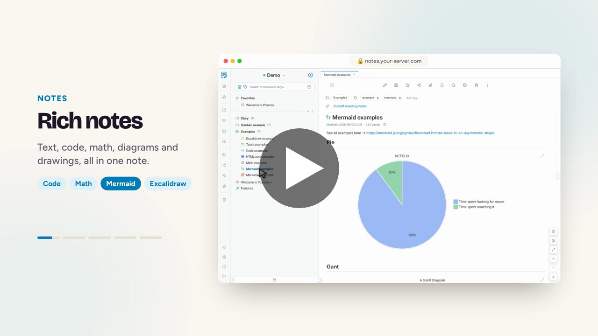
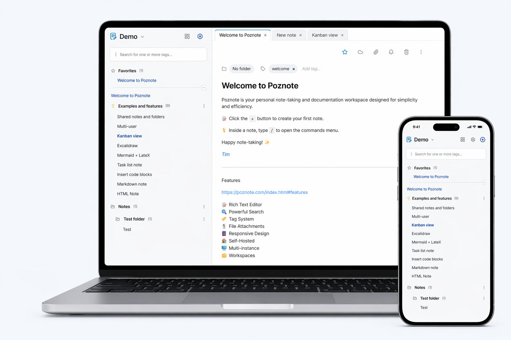

<!-- lang-selector -->
<p align="center">
  <a href="../README.md">English</a> ·
  <a href="README.fr.md">Français</a> ·
  <a href="README.de.md">Deutsch</a> ·
  <a href="README.es.md">Español</a> ·
  <a href="README.pt.md">Português</a> ·
  <a href="README.ru.md">Русский</a> ·
  <a href="README.zh-cn.md">简体中文</a> ·
  <a href="README.ko.md">한국어</a> ·
  <b>日本語</b>
</p>
<!-- /lang-selector -->


<p align="center">
  
</p>

<h2 align="center">
手間なく使える、パワフルなノートアプリ。
</h2>

<h3 align="center">
Notion、Obsidian、Evernote、OneNoteに代わる、無料でセルフホストできるオープンソースのアプリです。
</h3>

<p align="center">
  <a href="https://poznote.com/video/poznote.mp4"></a>
</p>

<p align="center">
  
</p>

### 機能

すべての機能は[こちら](https://poznote.com/#features)で紹介しています。

### スクリーンショット

すべてのスクリーンショットは[こちら](https://poznote.com/screenshots.html)で見られます。

### デモ

https://demo.poznote.com

**ユーザー名**：poznote<br>
**パスワード**：poznote

### サーバーを管理したくない場合

ホスティング会社にPoznoteの運用を任せることもできます。<br>
[ホスティング会社を比較する](https://poznote.com/hosting.html)か、そのままデプロイしてください：

<p>
  <a href="https://www.pikapods.com/pods?run=poznote"></a>
  <a href="https://calibernode.com/cloud-apps/poznote"></a>
</p>

### Poznoteの紹介記事

https://poznote.com/press.html

### Discord

コミュニティに参加して、質問したり、フィードバックを送ったり、開発の様子を追ったりできます：

https://discord.gg/fuEV6uqf4N

## 目次

- [インストール](#インストール)
- [アクセス](#アクセス)
- [設定の変更](#設定の変更)
- [アプリケーションのアップデート](#アプリケーションのアップデート)
- [認証](#認証)
- [アプリパスワード](#アプリパスワード)
- [ノートの種類](#ノートの種類)
- [リビジョン](#リビジョン)
- [カスタマイズ](#カスタマイズ)
- [マルチユーザー](#マルチユーザー)
- [共有と共同作業](#共有と共同作業)
- [アクティビティログ](#アクティビティログ)
- [Webhook](#webhook)
- [Git同期](#git同期)
- [添付ファイルのS3ストレージ](#添付ファイルのs3ストレージ)
- [バックアップ/エクスポート](#バックアップエクスポート)
- [復元/インポート](#復元インポート)
- [オフライン](#オフライン)
- [複数のインスタンス](#複数のインスタンス)
- [AIアシスタント](#aiアシスタント)
- [文字起こし（音声のテキスト化）](#文字起こし音声のテキスト化)
- [MCPサーバー](#mcpサーバー)
- [アプリ](#アプリ)
- [Chrome拡張機能](#chrome拡張機能)
- [AndroidからPoznoteに共有](#androidからpoznoteに共有)
- [APIドキュメント](#apiドキュメント)
- [技術スタック](#技術スタック)

## インストール

> 公式イメージはマルチアーキテクチャ（linux/amd64、linux/arm64）に対応しています。Docker Desktopを使えばWindowsやmacOSでも動き、Raspberry PiやNASなどのARM64デバイスでも動作します。

以下から、お好みのインストール方法を選んでください：

<a id="windows"></a>
<details>
<summary><strong>🖥️ Windows</strong></summary>

#### ステップ1：前提条件

[Docker Desktop](https://docs.docker.com/desktop/setup/install/windows-install/)をインストールして起動します。

#### ステップ2：Poznoteをデプロイ

新しいディレクトリを作成します：

```powershell
mkdir poznote
```

Poznoteのディレクトリに移動します：
```powershell
cd poznote
```

環境設定ファイルを作成します：

```powershell
curl -o .env https://raw.githubusercontent.com/timothepoznanski/poznote/main/.env.template
```

`.env`ファイルを編集します：

```powershell
notepad .env
```

Docker Composeの設定ファイルをダウンロードします：

```powershell
curl -o docker-compose.yml https://raw.githubusercontent.com/timothepoznanski/poznote/main/docker-compose.yml
```

最新のPoznote WebサーバーとPoznote MCPのイメージをダウンロードします：
```powershell
docker compose pull
```

Poznoteのコンテナーを起動します：
```powershell
docker compose up -d
```

</details>

<a id="linux"></a>
<details>
<summary><strong>🐧 Linux</strong></summary>

#### ステップ1：前提条件

1. [Docker Engine](https://docs.docker.com/engine/install/)をインストールします
2. [Docker Compose](https://docs.docker.com/compose/install/linux)をインストールします

#### ステップ2：Poznoteをインストール

新しいディレクトリを作成します：
```bash
mkdir poznote
```

Poznoteのディレクトリに移動します：
```bash
cd poznote
```

環境設定ファイルを作成します：
```bash
curl -o .env https://raw.githubusercontent.com/timothepoznanski/poznote/main/.env.template
```

`.env`ファイルを編集します：
```bash
vi .env
```

Docker Composeの設定ファイルをダウンロードします：
```bash
curl -o docker-compose.yml https://raw.githubusercontent.com/timothepoznanski/poznote/main/docker-compose.yml
```

最新のPoznote WebサーバーとPoznote MCPのイメージをダウンロードします：
```bash
docker compose pull
```

Poznoteのコンテナーを起動します：
```bash
docker compose up -d
```

</details>

<a id="macos"></a>
<details>
<summary><strong>🍎 macOS</strong></summary>

#### ステップ1：前提条件

[Docker Desktop](https://docs.docker.com/desktop/setup/install/mac-install/)をインストールして起動します。

#### ステップ2：Poznoteをデプロイ

新しいディレクトリを作成します：
```bash
mkdir poznote
```

Poznoteのディレクトリに移動します：
```bash
cd poznote
```

環境設定ファイルをダウンロードします：
```bash
curl -o .env https://raw.githubusercontent.com/timothepoznanski/poznote/main/.env.template
```

`.env`ファイルを編集します：
```bash
vi .env
```

Docker Composeの設定ファイルをダウンロードします：
```bash
curl -o docker-compose.yml https://raw.githubusercontent.com/timothepoznanski/poznote/main/docker-compose.yml
```

最新のPoznote WebサーバーとPoznote MCPのイメージをダウンロードします：
```bash
docker compose pull
```

Poznoteのコンテナーを起動します：
```bash
docker compose up -d
```

</details>

<a id="cloud"></a>
<details>
<summary><strong>☁️ クラウド</strong></summary><br>

サーバーを管理したくない場合は、ホスティング会社にPoznoteの運用を任せ、常に稼働させておくことができます。利用できるホスティング会社と、その選び方は[こちら](https://poznote.com/hosting.html)を参照してください。

<p>
  <a href="https://www.pikapods.com/pods?run=poznote"></a>
  <a href="https://calibernode.com/cloud-apps/poznote"></a>
</p>

</details>

<a id="proxmox"></a>
<details>
<summary><strong>🗄️ Proxmox VE</strong></summary><br>

Proxmox VEのホストでは、Proxmox VE Community Scriptsプロジェクトのスクリプトを使うと、1つのコマンドでPoznoteを専用のコンテナーにインストールできます。Dockerは使いません。非特権のDebian 13 LXC（既定ではvCPU 1基、RAM 512MB、ディスク4GB）を作成し、その中のnginxとPHPでPoznoteを動かします。

Proxmoxホストのシェルで次を実行します：

```bash
bash -c "$(curl -fsSL https://raw.githubusercontent.com/community-scripts/ProxmoxVE/main/ct/poznote.sh)"
```

インストールが終わると、Poznoteには`http://<container-ip>:8040`でアクセスできます。既定の認証情報は、ほかのインストール方法と同じです。あとでアップデートするには、コンテナーのコンソールで`update`を実行します。

このスクリプトは、Poznoteではなくコミュニティが作成し、保守しています。オプションと注意事項は[Poznoteのスクリプトのページ](https://community-scripts.org/scripts/poznote)を参照してください。

</details>

<a id="kubernetes"></a>
<details>
<summary><strong>☸️ Kubernetes（Helm）</strong></summary>

#### ステップ1：前提条件

[Helm](https://helm.sh/docs/intro/install/)をインストールし、Kubernetesのコンテキストが、Poznoteをデプロイするクラスターを指していることを確認します。

#### ステップ2：Poznoteをデプロイ

HelmForgeのチャートリポジトリを追加します：

```bash
helm repo add helmforge https://repo.helmforge.dev
```

ローカルのチャートのインデックスを更新します：

```bash
helm repo update
```

Poznoteをインストールします：

```bash
helm install poznote helmforge/poznote --namespace poznote --create-namespace
```

PoznoteのHelmチャートは、Kubernetesネイティブなインストール方法として、HelmForgeのコミュニティが保守しています。values、永続化、サービスの公開、プローブ、セキュリティコンテキストなど、本番運用向けの設定については[HelmForgeのPoznoteチャートのドキュメント](https://helmforge.dev/docs/charts/poznote)を参照してください。

</details>

<a id="rootless"></a>
<details>
<summary><strong>🔒 ルートレス</strong></summary><br>

Poznoteには、rootではなく非特権ユーザー（uid/gid `1000`）ですべてを実行する、ルートレス版のイメージもあります。コンテナー内でrootの使用を禁止している環境（Kubernetesの`PodSecurityStandard`のrestricted、ルートレスのPodman、`docker run --user`など）向けです。動作は既定のイメージとまったく同じで、違いは、コンテナー内ではポート`8080`で待ち受けることと、起動時にデータディレクトリの所有者を修正できないことだけです。

#### ステップ1：前提条件

1. [Docker Engine](https://docs.docker.com/engine/install/)をインストールします
2. [Docker Compose](https://docs.docker.com/compose/install/linux)をインストールします

#### ステップ2：Poznoteをデプロイ

新しいディレクトリを作成します：
```bash
mkdir poznote
```

Poznoteのディレクトリに移動します：
```bash
cd poznote
```

データディレクトリを作成し、所有者をuid/gid `1000`にします（**必須**：既定のイメージと違い、ルートレスのコンテナーは起動時に自分で所有者を修正できません）：
```bash
mkdir -p data
sudo chown -R 1000:1000 data
```

ここでは`sudo`が不要なことも多くあります。ユーザーのuidがすでに`1000`なら`chown`は省略でき、ルートレスのPodmanやDockerではrootなしで実行できます。[ルートレスでの実行](TROUBLESHOOTING.ja.md#running-rootless)を参照してください。

環境設定ファイルを作成します：
```bash
curl -o .env https://raw.githubusercontent.com/timothepoznanski/poznote/main/.env.template
```

`.env`ファイルを編集します：
```bash
vi .env
```

ルートレス版のDocker Composeの設定ファイルをダウンロードします：
```bash
curl -o docker-compose.rootless.yml https://raw.githubusercontent.com/timothepoznanski/poznote/main/docker-compose.rootless.yml
```

最新のPoznoteのルートレス版WebサーバーとPoznote MCPのイメージをダウンロードします：
```bash
docker compose -f docker-compose.rootless.yml pull
```

Poznoteのコンテナーを起動します：
```bash
docker compose -f docker-compose.rootless.yml up -d
```

既存のPoznoteインスタンスをルートレス版に移行する方法や、より詳しい情報は、トラブルシューティングガイドの[ルートレスでの実行](TROUBLESHOOTING.ja.md#running-rootless)を参照してください。

</details>

<br>

> インストールで問題が起きた場合は、[トラブルシューティングガイド](TROUBLESHOOTING.ja.md)を参照してください。

## アクセス

インストールが終わったら、Webブラウザーで次のURLを開いてPoznoteにアクセスします：

[http://localhost:8040](http://localhost:8040)


- ユーザー名：`admin_change_me`
- パスワード：`admin`
- ポート：`8040`

初回ログインの後、既定の管理者アカウントの名前と、既定のパスワードを変更してください。

## 設定の変更

日常的な設定の多くは、Poznoteの画面から変更します。`.env`ファイルは、コンテナーの起動時に読み込まれる、デプロイや実行時の値にだけ使います。

<details>
<summary><strong><code>.env</code>ファイルで設定するもの</strong></summary>
<br>

- `HTTP_WEB_PORT`
- `POZNOTE_OIDC_CLIENT_ID`
- `POZNOTE_OIDC_CLIENT_SECRET`
- `POZNOTE_OIDC_DISABLE_NORMAL_LOGIN`
- `POZNOTE_MCP_PORT`や`POZNOTE_DEBUG`など、実行時の値を上書きする任意の設定
- `POZNOTE_PHP_FPM_MAX_CHILDREN`：負荷の高いインスタンスで、同時に処理するPHPのリクエスト数（既定は10）を変更します。[トラブルシューティングガイド](TROUBLESHOOTING.ja.md#the-app-stops-answering-under-load)を参照してください
- `POZNOTE_PHP_MEMORY_LIMIT`：リクエストごとのPHPのメモリ上限をMB単位で変更します（既定は512）。[トラブルシューティングガイド](TROUBLESHOOTING.ja.md#a-request-runs-out-of-memory)を参照してください
- `POZNOTE_LISTEN_PORT`：コンテナー内でWebサーバーが待ち受けるポート（既定は80）を変更します。`network_mode: host`を使う場合にだけ必要です。[トラブルシューティングガイド](TROUBLESHOOTING.ja.md#running-with-host-network)を参照してください
- `POZNOTE_SETTINGS_PASSWORD`：設定ページを開く前に、追加のパスワードを求めます。既定では空です
- `POZNOTE_MCP_AUTH_TOKEN`：MCPクライアントにBearerトークンを要求します。[MCPサーバー](#mcpサーバー)を参照してください

</details>

<details>
<summary><strong>画面で設定するもの</strong></summary>
<br>

- 管理者が行う全体の設定：OIDCプロバイダーの設定、Git同期の有効化、インポートの上限、カスタムCSSのアップロードなど
- ユーザーやプロフィールごとの設定：ローカルアカウントのパスワード、テーマ、フォントサイズ、ノートの並べ替え、ワークスペースの背景、非表示にする画面要素など

</details>


### システム設定の変更（`.env`）

Poznoteのディレクトリに移動します：
```bash
cd poznote
```

実行中のPoznoteのコンテナーを停止します：
```bash
docker compose down
```

お好みのテキストエディター（`nano .env`や`notepad .env`など）で`.env`ファイルを編集します。

ファイルを保存し、コンテナーをもう一度起動して変更を反映します：
```bash
docker compose up -d
```

## アプリケーションのアップデート

Poznoteのディレクトリに移動します：
```bash
cd poznote
```

アップデートの前に、実行中のコンテナーを停止します：
```bash
docker compose down
```

最新のDocker Composeの設定ファイルをダウンロードします：
```bash
curl -o docker-compose.yml https://raw.githubusercontent.com/timothepoznanski/poznote/main/docker-compose.yml
```

最新の`.env.template`をダウンロードします：
```bash
curl -o .env.template https://raw.githubusercontent.com/timothepoznanski/poznote/main/.env.template
```

sdiffで`.env.template`を確認し、必要に応じて新しい変数を`.env`ファイルに追加します：
```bash
sdiff .env .env.template
```

最新のPoznote WebサーバーとPoznote MCPのイメージをダウンロードします：
```bash
docker compose pull
```

アップデートしたコンテナーを起動します：
```bash
docker compose up -d
```

データは`./data`ディレクトリに保存されており、アップデートの影響を受けません。

### ベータ版

ベータ版では、安定版としてリリースされる前の新機能を使えます。ベータ版は[リリースページ](https://github.com/timothepoznanski/poznote/releases)にプレリリースとして掲載され、`latest-and-beta`タグで公開されます。このタグは、ベータ版か安定版かにかかわらず、常に最新のバージョンを指します。

ベータ版を使うには、`docker-compose.yml`の2つの`image`行を変更します。ファイルのほかの部分はそのままにします：
```yaml
services:
  webserver:
    image: ghcr.io/timothepoznanski/poznote:latest-and-beta
    ...
  mcp-server:
    image: ghcr.io/timothepoznanski/poznote-mcp:latest-and-beta
    ...
```

[ルートレス](#rootless)版では、`docker-compose.rootless.yml`のWebサーバーのイメージは`poznote:latest-and-beta-rootless`になり、MCPのイメージは同じ`poznote-mcp:latest-and-beta`です。

イメージをダウンロードし、コンテナーを再起動します：
```bash
docker compose pull
docker compose up -d
```

*   **切り替える前に**：ベータ版にはまだバグが含まれている可能性があるため、先に[バックアップ](#バックアップエクスポート)を取ってください。問題は[GitHubのissue](https://github.com/timothepoznanski/poznote/issues)か[Discord](https://discord.gg/fuEV6uqf4N)で報告できます。
*   **アップデート**：以後は`docker compose pull`のたびに、最新のベータ版か、リリースされた安定版が取得されます。上のアップデート手順では、安定版のタグを使う新しい`docker-compose.yml`をダウンロードするので、その手順の後で2つの`image`行をもう一度変更してください。
*   **安定版に戻す**：ベータ版はデータベースを変更することがあるため、古い安定版に戻すと動かない場合があります。ベータ版の変更を含む次の安定版のリリースを待ってから、上のアップデート手順に従ってください。

## 認証

Poznoteは、ローカルアカウントや外部のIDプロバイダーなど、複数の認証方法に対応しています。REST APIを使うアプリや拡張機能は、[アプリパスワード](#アプリパスワード)を使います。これは別の認証情報で、次のセクションで説明します。

<details>
<summary><strong>ローカルアカウントによる認証</strong></summary>
<br>

Poznoteは、ユーザー名またはメールアドレスとパスワードを使って、プロフィールに設定されたユーザーを認証します。


#### 既定のアカウント

新規インストールでは、Poznoteは有効な管理者のプロフィールを1つ作成します：

- ユーザー名：`admin_change_me`
- パスワード：`admin`

初回ログインの後、既定のパスワードとアカウントの名前を変更してください。

#### パスワードの管理

パスワードは`.env`ではなく、PoznoteのWeb画面で管理します：

- ユーザーは、**設定 > パスワードを変更**から自分のパスワードを変更できます。
- 管理者は、**設定 > 管理ツール > ユーザー管理**から、任意のユーザーのパスワードを設定したり、既定のパスワードに戻したりできます。
- **30日間ログインしたままにする**オプションを使うと、セッションが30日間保持されます。
- パスワードを変更すると、そのユーザーのログイン状態を保持するための既存のCookieは無効になります。

#### 2要素認証

各ユーザーは、**設定 > 2要素認証**から2要素認証（TOTP）を有効にできます。有効にすると、ログインフォームはパスワードの後に、認証アプリ（Aegis、Google Authenticator、1Password、Bitwardenなど）の6桁のコードを求めます。

- 設定時には、ブラウザー内で描画されるQRコードと、スマートフォンをなくしたときのための使い捨てのリカバリーコード10個が表示されます。
- 2要素認証が保護するのは、パスワードによるログインです。SSOでのログインは、IDプロバイダーとその2要素認証に任されます。
- 有効にしている間、REST APIはアカウントのパスワードだけでは受け付けなくなります。クライアントには[アプリパスワード](#アプリパスワード)を使わせるか、`X-Poznote-OTP`ヘッダーで現在のコードを送ってください。
- 端末とリカバリーコードの両方をなくしたユーザーについては、管理者が**設定 > 管理ツール > ユーザー管理**（パスワードのダイアログ）から2要素認証を無効にできます。
- 管理者は**設定 > 管理ツール > 2要素認証を必須にする**から、パスワードでログインするすべてのアカウントに2要素認証を必須にできます。未設定のアカウントは次回のログイン時に設定し（ログインページにQRコードと最初のコードの入力欄が表示されます）、2要素認証なしで開かれたセッションは終了し、ユーザー自身では無効にできなくなります。SSOでのログインは対象外です。
- 2要素認証を有効または無効にすると、そのユーザーのログイン状態を保持するための既存のCookieは無効になります。

#### 既定のパスワード

- 管理者アカウント：`admin`
- 一般ユーザーのアカウント：`user`

ユーザーがまだパスワードを変更していない場合は、上の既定値が使われます。画面からパスワードを変更すると、安全なbcryptのハッシュがデータベースに保存され、そちらが優先されます。

</details>

<a id="oidc"></a>
<details>
<summary><strong>OIDC / SSOによる認証（任意）</strong></summary>
<br>

Poznoteは、シングルサインオンとの連携のためにOpenID Connect（認可コードフローとPKCE）に対応しています。ユーザーは、Auth0、Keycloak、Azure AD、Google Identityなどの外部のIDプロバイダーを使ってログインできます。

#### 仕組み

1. OIDCを有効にすると、ログインページに`Continue with [Provider Name]`ボタン（日本語の画面では「[プロバイダー名]で続行」）が表示されます。
2. ユーザーは、PKCEで保護されたOIDCの認可コードフローで認証します。
3. アクセスは、許可するグループで制限できます。必要なら、従来の許可ユーザーのリストも使えます。
4. 認証の後、Poznoteは、まず`sub`（`oidc_subject`）で、次に確認済みのメールアドレス（管理者が設定したもの、またはプロバイダーから同期したもの。大文字と小文字は区別しません）で、IDをプロフィールに結び付けます。既存のプロフィールが、ユーザー名で結び付けられることはありません。既存のプロフィールを初回のSSOログインで結び付けるには、**設定 > 管理ツール > ユーザー管理**で、そのプロフィールにプロバイダーが送るメールアドレスを設定するか、OIDCのsubjectを貼り付けます。初回のログインが拒否されると、貼り付けるべきsubjectがログに記録されます。
5. ユーザーの自動作成が有効で、一致するプロフィールがない場合、Poznoteはプロフィールを自動で作成します。このプロフィールには**パスワードがまったくありません**。管理者がアカウントを作成するときの初期認証情報の受け渡しを経ていないため、既定のパスワードではログインできません。ログインはプロバイダー経由で行うか、管理者が**設定 > 管理ツール > ユーザー管理**からパスワードを明示的に設定します。
6. `POZNOTE_OIDC_DISABLE_NORMAL_LOGIN=true`の場合、ユーザー名とパスワードのフォームは非表示になり、ログインページはSSO専用になります。
7. OIDCが有効な場合、REST APIのクライアントは`Authorization: Bearer <OIDC JWT>`で認証できます。Poznoteは、プロバイダーのJWKS、issuer、有効期限、audience、設定したアクセス制御を検証します。
8. OIDCのフローをまったく実行できないクライアント（ブラウザー拡張機能、モバイルアプリ、スクリプト）は、代わりに[アプリパスワード](#アプリパスワード)を使います。アプリパスワードは、各ユーザーが自分の設定から作成します。
9. [2要素認証](#2要素認証)が対象とするのはパスワードのフォームだけで、SSOでのログインではPoznoteのコードは求められません。2要素目は、IDプロバイダーの側で必須にしてください。パスワードとSSOのIDの両方を持つユーザーは、どちらの方法でもログインでき、SSOでのログインの強度はプロバイダーのポリシーで決まります。

#### 設定

OIDCは**管理画面**で設定します。**設定 > 管理ツール > OIDC / SSO**を開いてください。

ほとんどの設定（有効化、issuer、プロバイダー名、スコープ、アクセス制御、許可するグループやユーザー、ユーザーの自動作成、HTTP Basic認証の動作など）はこのページで管理し、データベースに保存されます。

REST APIのBearer JWT認証では、プロバイダーがAPI専用のaudienceに向けてアクセストークンを発行する場合に、**APIのJWT audience**を設定します。空の場合、Poznoteは設定されたOIDCのクライアントIDを、JWTのaudienceとして受け付けます。

次の設定は、引き続き`.env`ファイルで行います：

```bash
POZNOTE_OIDC_CLIENT_ID=your_client_id
POZNOTE_OIDC_CLIENT_SECRET=your_client_secret
POZNOTE_OIDC_DISABLE_NORMAL_LOGIN=false
```

ローカルのユーザー名とパスワードのフォームを非表示にし、SSOでのログインだけに限定したい場合は、`POZNOTE_OIDC_DISABLE_NORMAL_LOGIN=true`を使います。パスワード認証を止められるのは、この設定だけです。フォームを取り除き、パスワードのPOSTをサーバー側で拒否し、「パスワードを変更」の設定を非表示にします。

> **IDプロバイダーの障害からの復旧。** SSO専用とは、文字どおりの意味です。`POZNOTE_OIDC_DISABLE_NORMAL_LOGIN=true`の間は、管理者も含めて誰もパスワードでログインできないため、ブラウザーから抜け出す手段はありません。これは意図的なもので、管理者アカウントを乗っ取った攻撃者が、パスワードでのログインを再び有効にして、自分用の侵入経路を残すことはできません。復旧にはサーバーへのアクセスが必要です。`.env`で`POZNOTE_OIDC_DISABLE_NORMAL_LOGIN=false`を設定し、コンテナーを再起動して、ローカルのパスワードでログインします。SSO専用を有効にする前に、少なくとも1つの管理者アカウントにパスワードが明示的に設定されていることを確認してください（**設定 > 管理ツール > ユーザー管理**）。そうしないと、フラグを戻しても役に立ちません。なお、OIDCで自動作成された管理者のプロフィールには、設定するまでパスワードがありません。

> **互換性のない変更**：`.env`にあった以前のOIDCの設定は、`POZNOTE_OIDC_CLIENT_ID`、`POZNOTE_OIDC_CLIENT_SECRET`、`POZNOTE_OIDC_DISABLE_NORMAL_LOGIN`を除いて読み込まれなくなりました。アップグレードの後、ほかのOIDCの設定を管理ページで入力し直してください。

#### IDプロバイダーに登録するURL

IDプロバイダーでアプリケーション（クライアント）を作成するときは、次の1つ目のURLをリダイレクトURI（コールバックURLとも呼ばれます）として登録し、プロバイダーが求める場合は、2つ目のURLをログアウト後のリダイレクトURIとして登録します：

```text
https://YOUR_SERVER/oidc_callback.php
https://YOUR_SERVER/login.php
```

Poznoteは、どちらのURLも、リクエストを受けたホスト名から、常に`https://`で組み立てます。プロバイダーが別の値を必要とする場合は、OIDCの管理ページの「詳細」セクションで**リダイレクトURI**または**ログアウト後のリダイレクトURI**を設定し、その値をそのまま登録してください。

通常、Discovery URLを入力する必要はありません。Poznoteが**Issuer URL**に`/.well-known/openid-configuration`を付け加えます。たとえばAuthentikの場合、issuerは`https://AUTHENTIK_HOST/application/o/APPLICATION_SLUG/`です。プロバイダーがこのドキュメントを別の場所で公開している場合にだけ、**Discovery URL**を設定してください。

#### アクセス制御の例（グループと自動作成）

OIDCの管理ページで、次のように設定します：
- **グループのクレーム**：`groups`
- **許可するグループ**：`poznote`
- **OIDCでの初回ログイン時にユーザープロフィールを自動作成**：有効

自動作成が有効な場合、PoznoteはOIDCのクレーム（`preferred_username`、`nickname`、メールアドレスのローカル部、`name`、最後に`sub`の順）からユーザー名を生成し、作成したプロフィールにOIDCのsubjectを保存します。SSOで一度もログインしたことのない既存のプロフィールが、すでにその`preferred_username`を使っている場合は、2つ目のプロフィールを作らずに、ログインを拒否します。そのプロフィールに、プロバイダーが送るメールアドレスかOIDCのsubjectを設定して、結び付けてください。

</details>

## アプリパスワード

アプリは、ブラウザーのようにIDプロバイダーを通してログインすることができません。**アプリパスワード**は、1つのクライアント（ブラウザー拡張機能、スマートフォン、スクリプト）のために作成する別の認証情報で、いつでも取り消せます。そのため、アカウントのパスワードを渡す必要がありません。

**設定 > アプリパスワード**から作成します。名前と、必要なら有効期限を指定し、生成されたシークレットをコピーします。シークレットは一度だけ表示され、二度と表示されません。次に、クライアントで、いつものユーザー名を入力し、パスワードを求められる欄にアプリパスワードを入力します。通常のHTTP Basic認証として送られるので、既存のクライアントはどれもそのまま使えます：

```bash
curl -u 'username:pzn_2f7c…' https://YOUR_SERVER/api/v1/notes
```

アプリパスワードで使えるのはREST APIだけで、対象は自分のプロフィールに限られます。アカウントが管理者であっても、Web画面を開くこと、管理者用のエンドポイントを呼び出すこと、パスワードの変更、アカウントの管理はできません。そのため、漏えいしても影響は1つのアカウントのノートにとどまり、取り消せば穴はふさがります。OIDCで作成したアカウントにパスワードがまったくないSSO専用のインスタンスでは、アプリパスワードが、APIがBasic認証で受け付ける唯一の認証情報になります。

制限の一覧と、アプリパスワードを管理するエンドポイントは、[REST APIのドキュメント](API-REST.md#authentication)に記載しています。

## ノートの種類

Poznoteは、主に2つのノート形式に対応しており、それぞれ異なる使い方に合わせて作られています。

<details>
<summary><strong>リッチテキストのノート</strong></summary>
&nbsp;

*   **エディター**：WYSIWYG（What You See Is What You Get）で直接編集します。
*   **保存形式**：ユーザーのデータディレクトリに`.html`ファイルとして保存されます。標準的なHTMLなので、どのWebブラウザーでも直接開けます。
*   **専用の機能**：
    *   **豊富な書式**：文字色、ハイライト、標準的なHTML要素にネイティブで対応します。
    *   **直感的な操作**：エディター内で要素を直接操作できます。
</details>

<details>
<summary><strong>Markdownのノート</strong></summary>
&nbsp;

*   **エディター**：リアルタイムのプレビュー付きのMarkdownエディターです。
*   **保存形式**：ユーザーのデータディレクトリに`.md`ファイルとして保存されます。
*   **専用の機能**：
    *   **Mermaidの図**：` ```mermaid `のコードブロックで、図（フローチャート、シーケンス図など）をネイティブで生成できます。
    *   **数式**：`$ inline $`と`$$ block $$`の構文で、LaTeXの数式をしっかりサポートします。
    *   **移植性**：標準的なMarkdown形式なので、外部のエディターや静的サイトジェネレーターでもそのまま使えます。
</details>

<details>
<summary><strong>タスクリスト</strong></summary>
&nbsp;

*   **用途**：インタラクティブなチェックリストで、タスクやプロジェクトを管理します。
*   **ワークフロー**：エディターやノート一覧で直接切り替えられるチェックボックスで、進み具合を追跡します。各リストの完了状況は進捗バーで表示されます。
*   **タスクのオプション**：各タスクには、期限（時刻は任意）、期限の時刻に届くリマインダー通知、重要フラグを設定でき、別のリストへ移動することもできます。
*   **タスクページ**：左のアイコンサイドバーから開く専用の「タスク」ページに、すべてのタスクリストのタスクと、必要に応じて通常のノート内のチェックボックスを、1か所にまとめて表示します。ステータスのフィルター（未完了、重要、期限切れ、期限あり、完了済み）、テキストでの絞り込み、期限のあるタスクのカレンダー表示を備えています。タスクリストやノートのチェックボックスは、ヘッダーにある目のボタンでページから非表示にでき、**非表示のリストを表示**で元に戻せます。この選択はアカウントに保存されるので、別の端末に移っても引き継がれます。
*   **公開での共同作業**：タスクリストは公開URLで共有できます。編集権限を与えると、外部の共同作業者は、Poznoteのアカウントがなくてもリストの項目にチェックを付けられます。
</details>

<details>
<summary><strong>ショートカット</strong></summary>
&nbsp;

*   **機能**：既存のノートへの参照を、別の場所に作成します。
*   **使い方**：1つのノートを、2つの場所から同時に参照できます。たとえば、ノートは分類用のフォルダーに置いたまま、そのショートカットをカンバンボードに置いて、進行中の作業として追跡できます。
</details>

<details>
<summary><strong>テンプレート</strong></summary>
&nbsp;

*   **機能**：用意しておいた内容を再利用して、ドキュメントの形式を揃えます。ノート全体から短い断片まで使えます。
*   **準備**：再利用したいノートを、`Templates`という名前のフォルダーに入れます（サブフォルダーも使えます）。`Templates`という名前のワークスペースも使え、どのワークスペースからも利用できます。この名前は、画面の言語での名前でも認識されます（`Modèles`、`Vorlagen`、`Plantillas`、`Modelos`、`Шаблоны`、`模板`、`템플릿`、`テンプレート`）。
*   **ノートに挿入**：リッチテキストまたはMarkdownのノートで`/template`（または`/`に続けてテンプレートのタイトル）を入力し、テンプレートを選びます。カーソルの位置に内容が貼り付けられます。テンプレートとノートの種類が違う場合は変換されます。
*   **テンプレートから新規ノート**：テンプレートのノートを複製します。`Templates`フォルダーをまるごと複製すれば、フォルダー構成ができあがった状態でプロジェクトを始められます。
</details>

<details>
<summary><strong>デイリーノート（日記）</strong></summary>
&nbsp;

*   **用途**：専用の「日記」ボードで、日記のように1日1つのノートを書きます。
*   **ワークフロー**：「今日のエントリを作成」ボタンで今日のノートを作成します（ノートができた後は「今日のエントリへ移動」と表示されます）。ノートのタイトルは今日の日付になり、`日記/YYYY/MM`のフォルダー構成に自動で保存されます（英語の画面では`Diary/YYYY/MM`）。
*   **別の日**：表示切り替えのボタンの隣にあるカレンダーのボタンで、任意の日を選べます（スマートフォンでも使えます）。エントリのある日には点が付きます。そうした日を選ぶとそのエントリが開き、ほかの日を選ぶとその日付のエントリが作成されます。
*   **ボード表示**：エントリは月ごとにまとめたカードとして新しい順に表示され、フィルターで過去のエントリをすばやく探せます。
*   **ジャーナル表示**：表示切り替えのボタンの隣にあるスクロールのボタンで、1列で読む表示に切り替わります。すべてのエントリが内容ごと新しい順に並び、スクロールに合わせて読み込まれます。ここでもフィルターを使えます。エントリかその鉛筆のアイコンをクリックすると、その場で編集でき、変更は入力と同時に保存されます。鉛筆の隣にあるタグのボタンを押すと、エントリのタグを編集できる状態になり、ノートを開かずにタグを追加したり外したりできます。
*   **形式**：新しいエントリは、**設定 > 日記**の「日記のエントリの形式」の設定に応じて、リッチテキストまたはMarkdownのノートとして作成されます。
*   **テンプレート**：新しいエントリを毎回同じ内容（見出し、チェックボックスなど）で始めるには、そのノートをワークスペースの`Templates`フォルダーに置き、**設定 > 日記**の「日記のエントリのテンプレート」で選びます。テンプレートはワークスペースごとに、そのワークスペースのノートの中から選びます。設定するには、そのワークスペースから設定を開いてください。テンプレートの形式がエントリと違う場合は変換されます。
</details>

## リビジョン

リビジョンは、ノートの以前の内容を、タイトルやタグと一緒に保存します。現在のノートと比べたり、以前の状態に戻したりできます。ノートのツールバーにある履歴のアイコンで、そのノートの**リビジョン**ページが開きます。

<details>
<summary><strong>リビジョンページ</strong></summary>
<br>

*   **履歴**：左の列には、ノートのリビジョンが日ごとにまとめて表示され、それぞれに「自動」「手動」「AIによる編集の前」「MCPによる編集の前」のいずれかのラベルが付きます。「現在」のバッジは現在のノートと同じリビジョンに、「変更なし」のバッジは1つ前のリビジョンと同じリビジョンに付きます。どちらのバッジも、タイトルとタグが同じであることも条件です。
*   **内容**：ページはこのタブで開き、選択したリビジョンそのものを描画して表示します。Markdownのノートでは、タブの隣に「プレビュー」と「ソース」の切り替えがあります。
*   **変更点**：2つ目のタブでは、現在の内容、1つ前のリビジョン、またはほかの任意のリビジョンとの差分を、変わった単語を強調して行単位で表示します。差分は「統合」か「左右に並べる」で表示できます。変更のない行は折りたたまれ（クリックで展開）、前後の変更へ移動するボタンで変更から変更へ移れます。追加された行と削除された行の数も表示されます。Markdownのノートはソースで比較します。リッチテキストのノートはテキストで比較するため、書式だけの変更は表示されません。差分の上には、比較する2つの内容のあいだでのタイトルの変更（旧 → 新）と、追加されたタグや外されたタグが表示されます。
*   **操作**：「操作」メニューには「このリビジョンを復元」「リビジョンを保存」「内容をコピー」「このリビジョンを削除」があります。「リビジョンを保存」は現在の内容をすぐに保存し、ほかの項目は選択したリビジョンに対して動作します。
*   **復元**：復元すると、ノートの内容、タイトル、タグがリビジョンのものに戻ります。置き換えられる状態は保存されません。必要なら、先にリビジョンを保存してください（「操作」メニューの「リビジョンを保存」、または**Ctrl + Alt + S**）。復元したタイトルには名前の変更と同じ規則が適用され、同じフォルダーの別のノートがすでにそのタイトルを使っている場合は、「(1)」のような接尾辞が付きます。タグを記録するようになる前に保存されたリビジョンにはタグがなく、復元してもノートのタグは変わりません。

</details>

<details>
<summary><strong>リビジョンの仕組み</strong></summary>
<br>

*   **自動**：Poznoteは、ノートを開いたときではなく、ノートが変更されたときにリビジョンを保存します。ノートの内容、タイトル、タグへの変更が保存されるたびに（エディターの自動保存、タスクのチェック、描画の保存、REST API、公開リンクからの編集）、Poznoteはまず、その変更の直前の状態のノートを保存します。ただし、そのノートのリビジョンが直近10分以内にすでに作成されている場合は保存しません。そのため、リビジョンは常に変更前の状態を保持し、1回の編集セッションで作られる自動リビジョンは、多くても10分に1つです。ノートを開いたり読んだりしても、リビジョンは作成されません。空のノートの場合や、最新のリビジョンが現在の内容、タイトル、タグとまったく同じ場合は何も保存されないので、履歴に重複はできません。これらのリビジョンには、履歴で「自動」のラベルが付きます。以前のバージョンのPoznoteがノートを開いたときに作成したリビジョンにも同じラベルが付き、同じ規則に従います。
*   **例**：9:00から9:35までノートを編集したとします。履歴には、9:00ごろ（編集を始める前のノート）、9:10、9:20、9:30のリビジョンが作られます。14:00に戻って単語を1つ変えると、14:00のリビジョンに、9:35に編集を終えたときの状態のノートが保存されます。
*   **戻せる状態**：セッションの終わりにノートを離れたときの状態は、その時点ではリビジョンとして保存されません。それはノートそのものだからです。この状態は、どれだけ後であっても、次のセッションの最初の変更で保存されます。そのため、今日編集を始める前のノートの状態には必ず戻せますし、長いセッションの中でも、最大で約10分間隔の状態に戻せます。最新の状態は常にノートそのものです。任意のリビジョンを「現在の内容」と比べると、その後に何が変わったかを確認できます。
*   **自動リビジョンの保持期間**：直近24時間の自動リビジョンはすべて保持されます。24時間を過ぎると、各日の最新の自動リビジョンだけが、既定では30日間保持されます。この日数は**設定 > リビジョン**で変更できます（1〜30）。以前のバージョンでこの設定を変更していた場合（当時はリビジョンの数を指定する設定でした）、その値はそのまま保持され、今後は日数として扱われます。
*   **手動**：「リビジョンを保存」で、いつでもリビジョンを追加できます。ノートを開いている間は、**Ctrl + Alt + S**（MacではCmd + Alt + S）でも追加できます。手動のリビジョンは数に上限がなく、間引かれることもありません。なくなるのは、30日後に期限が切れたときだけです。
*   **AIによる編集の前**：[AIアシスタント](#aiアシスタント)や[MCPサーバー](#mcpサーバー)がノートの内容を変更する直前に、リビジョンが自動で保存されます。10分以内に自動リビジョンが作られていても保存されるので、書き換えがうまくいかなかったときは、ワンクリックで元に戻せます。これらのリビジョンには、履歴で「AIによる編集の前」または「MCPによる編集の前」のラベルが付きます。最新のリビジョンがすでに同じ内容、タイトル、タグを保持している場合は保存されません。
*   **安全用リビジョン**：「AIによる編集の前」と「MCPによる編集の前」のリビジョンには、共通の上限があります。ノートごとに最新の20件が保持されます。インスタンスでAIやMCPを使って多くのノートを編集する場合は、この数を**設定 > リビジョン**で変更できます（1〜200）。
*   **期限切れ**：すべてのリビジョンは、種類にかかわらず、保存から30日後に削除されます。リビジョンページから手動で削除することもできます。
*   **添付ファイルと画像**：リビジョンに保存されるのはノートのテキスト、タイトル、タグで、ファイルは保存されません。添付ファイルはコピーされないので、複数のリビジョンから参照されるファイルも、ディスク上には1つだけです。ノートから削除したファイルは、それを含むリビジョンが残っている間は、ノートからは見えない状態でディスクに残ります。そのため、そのリビジョンを復元するとファイルも戻ります。ファイルが完全に削除されるのは、それを含む最後のリビジョンが期限切れになるか削除されたとき、またはノートが完全に削除されたときです。したがって、リビジョンを多く保持してもファイルが重複することはありません。削除したファイルが長く残るだけで、それも最大で30日です。
*   **APIとMCP**：[REST API](API-REST.md#snapshots)と[MCPサーバー](#mcpサーバー)のツールでは、リビジョンは今も「snapshots」と呼ばれています（`/notes/{id}/snapshots`、`list_snapshots`、`get_snapshot`、`restore_snapshot`）。

</details>

## カスタマイズ

Poznoteには、設定ファイルを変更しなくても、アプリから直接使えるカスタマイズのオプションがいくつも用意されています。

<details>
<summary><strong>表示、動作、Markdownの設定</strong></summary>
<br>

**設定 > 表示**では、次の項目を設定できます：

- **アプリのフォント**：画面全体で使う書体を選びます
- **フォントサイズ**：ノート、サイドバー、コードブロック、設定ページの文字の大きさを調整します
- **ノートの色**：ノートに色を付けるときに表示されるパレットを選びます
- **ノートの種類ごとのアイコン**：ノート一覧で、タスクリストとMarkdownのノートに専用のアイコンを付けます
- **ノート一覧のアイコンの拡大率**：ノート一覧のアイコンの大きさを変更します
- **アイコンサイドバーのレイアウト**：左のアイコンサイドバーのボタンを並べ替え、色を変更します（アイコンサイドバーのボタンを右クリックしても、色の選択が開きます）
- **ノートの内容の幅**：ノートのエディター領域の最大幅を調整します
- **添付ファイルのプレビュー**：添付ファイルをノート内でプレビュー表示します
- **画像の既定の枠線（余白なし）**：挿入した画像に、余白を加えずに枠線を付けます
- **現在のフォルダー階層を強調表示**：作業中のフォルダー階層の外にあるノートとフォルダーを薄く表示します
- **ログインページのタイトル**：ログインページに表示するタイトルを変更します
- **要素の表示**：使わない画面要素を非表示にします。下記を参照してください

動作に関する設定では、次の項目を設定できます：

- **ノートの並べ替え**：一覧でのノートの並び順を選びます
- **ノートの期間フィルター**：指定した日数以内に更新したノートだけを一覧に表示します
- **リビジョン**：自動リビジョンを保持する日数（直近24時間を過ぎたものは1日1件）と、ノートごとに保持する安全用リビジョンの数
- **タスクの追加位置**：新しいタスクを追加する位置を指定します
- **フォルダーのないノートをフォルダーの後に表示**：フォルダーに入っていないノートを、フォルダーの一覧の下に表示します
- **コードブロックの折り返し**：コードブロックでの折り返しを有効または無効にします
- **日記のエントリの形式**：日記のエントリを、リッチテキストとMarkdownのどちらのノートとして作成するか
- **日記のエントリのテンプレート**：ワークスペースの`Templates`フォルダーにあるノートで、そのワークスペースの新しい日記のエントリはすべて、この内容から始まります
- 画面の言語、タイムゾーンと日付の形式、ノート下部の添付ファイルとバックリンク、スペルチェック、キーボードショートカット

**設定 > Markdown**では、既定の表示モード、ノートの表示ボタンで切り替わる表示（ライブプレビュー、リッチテキスト、分割）、エディターのフォント、枠付きのMarkdownとMarkdownの色付け、コードブロックの行番号を設定できます。

テーマは、ここにはカードとしてありません。左のアイコンサイドバーの下部にあるボタンで、テーマを順に切り替えます。どのテーマを選べるようにするかは、管理者が**設定 > 管理ツール > テーマ一覧**で決めます。

</details>

<details>
<summary><strong>ワークスペースの背景画像</strong></summary>
<br>

ワークスペースごとに背景画像を設定できます。**設定 > ワークスペース**を開き、ワークスペースの**背景**の操作で画像をアップロードして不透明度を調整すると、ワークスペースごとに見た目を変えられます。

</details>

<details>
<summary><strong>要素の表示</strong></summary>
<br>

使わない要素を非表示にして、画面をすっきりさせられます。

**設定 > 表示 > 要素の表示**で設定します。

- **細かな制御**：ホームのカード、ツールバーの操作、スラッシュメニューの項目などの表示を切り替えられます。ノートの作成日のバッジ（**作成日を表示**）や、各フォルダーの隣のノート数（**フォルダーのノート数を表示**）のオン/オフも、ここで切り替えます。
- **ユーザーごと**：ユーザーごとに、独自の画面レイアウトを持てます。
- **管理者**：同じダイアログで、管理者自身の「自分」の列の隣に「ユーザー」の列も表示され、インスタンスのすべてのユーザー（管理者を除く）に対して要素を非表示にできます。
- **検索**：ダイアログのフィルターで、非表示にしたい要素をすぐに見つけられます。

</details>

<details>
<summary><strong>カスタムフォント</strong></summary>
<br>

PoznoteにはInterが付属しており、端末にインストールされているフォントも使えます。ほかのフォント（たとえばGoogle Fontsのファミリー）を使うには、管理者がそのファイルを一度アップロードします。その後は、どのユーザーもそのフォントを選べます。

**設定 > 管理ツール > カスタムフォント**でアップロードし、**設定 > 表示 > アプリのフォント**または**設定 > Markdown > Markdownエディターのフォント**でフォントを選びます。

注意事項：

- 対応している形式はWOFF2、WOFF、TTF、OTFで、1ファイルあたり10MBまでです。
- ファミリーは、複数のファイル（標準、太字、斜体など）か、1つの可変フォントのファイルで構成されます。1つのファミリーのファイルは、1回のアップロードですべて選択してください。ファミリー名でまとめられます。
- フォントは自分のインスタンスから配信され、Googleやその他の第三者からは何も読み込みません。先にファミリーを[Google Fonts](https://fonts.google.com)（**Get font > Download all**）か[google-webfonts-helper](https://gwfh.mranftl.com/fonts)からダウンロードしてください。
- 太字のファイルがないファミリーでは、太字の文字と見出しに既定のフォントが使われるので、太字のファイルもアップロードしてください。
- ファイルは`data/fonts/`（Dockerのボリューム）に保存されるため、イメージをアップデートしても残ります。手動でそこにコピーしたファイルは、**カスタムフォント**のダイアログを開いたときに読み込まれます。
- フォントは各ユーザーが選びます。ファミリーを削除すると、そのフォントを選んでいたユーザーは既定のフォントに戻ります。
- フォントをアップロードしたり削除したりできるのは、管理者だけです。

</details>

<details>
<summary><strong>カスタムCSSによる上書き</strong></summary>
<br>

組み込みのオプションの範囲を超えて、フォントや余白などの見た目を調整したい場合は、追加のスタイルシートをアップロードできます。スタイルシートは、すべてのユーザーのすべてのHTMLページに適用されます。

**設定 > 管理ツール > カスタムCSS**で設定します。

注意事項：

- **CSSファイルをアップロード**をクリックして、コンピューターから`.css`ファイルを選びます。
- アップロードしたファイルはすべて保存されるので、複数のテーマを保存しておき、アップロードし直さずに切り替えられます。
- ダイアログには、保存されているファイルが一覧表示されます。すべてのユーザーに適用するものを選ぶか、**カスタムCSSなし**を選んで組み込みの外観に戻し、**保存**をクリックします。
- 保存済みのファイルと同じ名前のファイルをアップロードすると、そのテーマが置き換わります。
- ファイルは`data/css/`（Dockerのボリューム）に保存されるため、イメージをアップデートしても残ります。
- テーマの隣にあるゴミ箱のアイコンをクリックすると、そのファイルがボリュームから削除されます。
- Poznoteは、キャッシュを回避するための`v=`パラメーターを自動で付け加えます。
- スタイルシートは`<head>`の末尾近くに挿入されるので、アプリの既定のスタイルを上書きできます。
- カスタムCSSファイルをアップロード、適用、削除できるのは、管理者だけです。

### テーマ一覧

**設定 > 管理ツール > テーマ一覧**では、アイコンサイドバーの下部にあるテーマボタンで切り替わるテーマを指定します。クリックするたびに、表示されている順に1つずつテーマが切り替わります。

- 残したい組み込みのテーマにチェックを入れ、誰も使わないテーマはチェックを外します。
- 保存済みのCSSファイルにチェックを入れると、独立したテーマとして使えるようになります。パレットのアイコンとファイル名が付きます。
- 矢印で、ボタンで切り替わる順序を設定します。
- カスタムテーマはライトかダークのベースの上に色を塗りますが、どちらのベースかはファイル自体からは判断できません。ファイルの隣で選んでください。これが`data-theme`に設定される値なので、ダークモード用に書いたスタイルシートには、ここで**ダーク**を選ぶ必要があります。
- 一覧はインスタンス全体の設定なので、全員が同じテーマを順に切り替えます。どのテーマを適用するかは、各ユーザーが選びます。
- 一覧から外したテーマを使っているユーザーには、すぐに一覧の最初のテーマが適用されます。
- カスタムテーマを選ぶと、インスタンス全体に適用されているスタイルシートの代わりに、そのユーザーにだけそのファイルが読み込まれます。
- CSSファイルを削除すると、一覧からも削除されます。
- 一覧のテーマが1つだけの場合は切り替える先がないので、管理者がボタンを押すとこの一覧が開き、ほかのユーザーが押しても何も起こりません。

**CSSを書く前に**、組み込みのテーマで目的を果たせないか確認してください。アイコンサイドバーの下部にあるテーマボタンで、ライト、ダーク、ブラック、ラベンダー、セピア、ターミナルを順に切り替えられます。

### 例

色、余白、角の丸み、フォントの太さはデザイントークンになっているので、ほとんどの変更は、セレクターと格闘しなくても、変数をいくつか上書きするだけで済みます。トークンの一覧は`src/public/css/tokens.css`にあります。

**アクセントカラーを変更する**

```css
:root {
    --pz-accent: #d6336c;
    --pz-accent-hover: #a61e4d;
    --pz-accent-rgb: 214, 51, 108;   /* same colour, channels only, used for tints */
}
html[data-theme='dark'] {
    --pz-accent-text: #f783ac;       /* lighter, because it sits on a dark ground */
}
```

トークンが1つではなく2つなのは、*塗り*と*ラベル*を同じ色にはできないためです。`--pz-accent`はボタンを塗りつぶす色で、`--pz-accent-text`は文字、アイコン、輪郭線に使うアクセントカラーです。ライトテーマでは`--pz-accent-text`は自動的に`--pz-accent`に従いますが、暗い背景にはより明るい値が必要です。どのトークンも、すべてのテーマで同じ`--pz-*`の名前を持ち、変わるのは値だけです。古いスタイルシートの`--dm-*`の名前も、引き続き使えます。

**ノートのツールバーのアイコンの色を変える**

```css
.note-edit-toolbar .toolbar-btn i,
.note-edit-toolbar .toolbar-btn [class*="lucide-"],
.note-edit-toolbar .toolbar-btn:hover i,
.note-edit-toolbar .toolbar-btn:hover [class*="lucide-"] {
    color: #e5322d !important;
}
```

アイコンは`background-color: currentColor`で塗られたCSSマスクなので、`color`を指定するだけで済みます。ここで`!important`が必要なのは、一部のアイコンがすでに独自の色を持っているためです（ノートがお気に入りのときの星、公開しているときの共有アイコン、添付ファイルがあるときのクリップ）。

アイコンを1つだけ色付けするなら、CSSは不要です。ノートのツールバーかアイコンサイドバーでアイコンを右クリックし、色を選びます。この色はユーザーごとに保存され、上に挙げた状態を表す色には影響しません。

**画面全体を暖色系にする**

```css
:root {
    --pz-bg: #f6ecd8;          /* page and note background */
    --pz-surface: #efe0c4;     /* panels, cards, menus */
    --pz-text: #3b2c1a;
    --pz-border: #d4bd94;
}
```

**テーマを一から書く**

ライト用には`:root`で、ダーク用には`:root[data-theme='dark']`でトークンを上書きし、それ以外には手を加えません。`src/public/css/README.md`に、すべてのトークンの説明と完全な例があります。`src/public/css/tokens.css`にある組み込みのラベンダー、セピア、ターミナルのテーマも、同じ方法で書かれています。

</details>

## マルチユーザー

> [複数のインスタンス](#複数のインスタンス)の機能と混同しないでください。

Poznoteはマルチユーザーに対応しています。各プロフィールは、自分専用のノート、ワークスペース、タグ、フォルダー、添付ファイル、設定を持ち、自分のユーザー名またはメールアドレスとパスワードでログインします。

- **ユーザー管理**：管理者は、**設定 > 管理ツール > ユーザー管理**からプロフィールを作成、無効化、管理できます。また、所有権を移さずに、あるユーザーに別のユーザーのアカウントへのアクセスを与えることもできます。
- **共有と共同作業**：ワークスペース、ノート、フォルダーを、インスタンスのほかのユーザーと共有できます。[共有と共同作業](#共有と共同作業)を参照してください。
- **テナント分離（SaaSモード）**：管理者は、管理者以外のユーザーが、インスタンスのほかのアカウントを見つけたり、それらと共有したり、個人用のWebhookを登録したりできないようにできます。家族やチームで使うインスタンスでは、すべてチェックを外したままにしてください。
- **ローカルネットワークへのアクセス**：管理者以外のユーザーがWebhook、Git同期、自分用のAI、文字起こし、MCPのサーバーの接続先にできるのは、インターネット上の公開ホストと、管理者が許可したローカルのホストだけです。[管理者以外のユーザーによるローカルネットワークへのアクセス](#local-network-access)を参照してください。

<a id="local-network-access"></a>
<details>
<summary><strong>管理者以外のユーザーによるローカルネットワークへのアクセス</strong></summary>
<br>

いくつかの機能では、ユーザーが入力したアドレスに、Poznoteのサーバー自身が接続します。Webhook、Git同期、ユーザー自身が設定するAIサーバー、文字起こしサーバー、MCPサーバーです。リクエストは、ユーザーのブラウザーではなくサーバーから送られます。制限がなければ、どのアカウントでも、Poznoteを使ってサーバー自身、ほかのDockerコンテナー、ローカルネットワーク、クラウドのメタデータサービスなど、本来は自分では届かない場所にアクセスできてしまいます。

そのため、規則はアドレスを入力したのが誰かによって変わります：

- **管理者**には制限がありません。もともとサーバーを管理する立場にあるためです。
- **ほかのユーザー**が使えるのは、インターネット上の公開ホストだけです。ローカルまたはプライベートのアドレスは拒否されます。対象は、`localhost`と`127.0.0.1`、`10.x.x.x`、`172.16.x.x`〜`172.31.x.x`、`192.168.x.x`、`169.254.x.x`、ローカルのIPv6アドレス（`fc00::/7`、`fe80::/10`）、そしてこれらのいずれかを指す名前（別のDockerサービスの名前など）です。

管理者がインスタンス全体に対して設定するもの（AIアシスタント、文字起こし、管理者用Webhook、S3、OIDC、SMTP）は影響を受けません。

家族やチームで使うインスタンスでは、ユーザーがネットワーク内のサーバーを必要とすることがあります。たとえば、個人用のAIのためのOllamaサーバーや、Webhookのためのn8nです。そうしたホストを、**設定 > 管理ツール > 連携 > ローカルネットワークへのアクセス**に、1行に1つずつ入力します：

| エントリ | 許可されるもの |
|---|---|
| `ollama`または`ollama.lan` | このホスト名（どのアドレスを指していても許可。Dockerのサービス名も使えます） |
| `*.home.arpa` | このドメイン配下のすべてのホスト名 |
| `192.168.1.20` | このアドレス |
| `192.168.1.0/24` | このネットワークのすべてのアドレス（IPv6も使えます。例：`fd00::/8`） |

エントリは、そのホストのすべてのポートを許可します。無効なエントリは保存時に拒否され、直すべきエントリの一覧が表示されます。カードには、一覧が空の間は**公開ホストのみ**と表示され、それ以外のときはエントリの数が表示されます。

注意点：

- 一覧のホスト名は、自分のコンピューターからだけでなく、Poznoteのコンテナー内から名前解決できる必要があります。自分のコンピューターやルーターしか知らない名前はPoznoteでは名前解決できず、ほかの不明な名前と同じく拒否されます。その場合は、代わりにアドレスかネットワークを入力してください。
- アドレスは、保存時だけでなく接続のたびに確認されます。エントリを削除するとすぐに反映され、後からローカルのアドレスを指すようになった名前は拒否されます。
- 管理者以外のユーザーについては、Poznoteはリダイレクトをたどりません。例外はGit同期で、リダイレクトの各段階を改めて確認します。

</details>

<details>
<summary><strong>ディスク上のデータの配置</strong></summary>
<br>

Poznoteは、ユーザー間で共有する管理用のデータにはマスターデータベース（`data/master.db`）を使い、ノートの実際の内容には、ユーザーごとに分かれたデータベースとファイルを使います。

```
data/
├── master.db                    # プロフィール、全体の設定、共有リンク、アカウントへのアクセス権、編集のロック
├── css/                         # 管理者がアップロードしたカスタムCSSファイル
├── fonts/                       # 管理者がアップロードしたカスタムフォント
├── backups/                     # スケジュールによるローカルバックアップ（ユーザーIDごとに1フォルダー）
└── users/
    ├── 1/                       # ユーザーID 1（既定の管理者）
    │   ├── database/poznote.db  # ユーザーのノートのデータベース
    │   ├── entries/             # ユーザーのノートのファイル（HTML/MD）
    │   ├── attachments/         # ユーザーの添付ファイル
    │   ├── snapshots/           # ユーザーのノートの以前の内容（リビジョン）
    │   ├── backgrounds/         # ワークスペースの背景画像
    │   └── backups/             # ダウンロード用に準備したバックアップのアーカイブ
    ├── 2/                       # ユーザーID 2
    └── ...
```

</details>

## 共有と共同作業

Poznoteでは、各自が自分のアカウントを使いながら、インスタンスのほかのユーザーと一緒に作業する方法がいくつかあります。共通の場所（家族、友人、チーム）が欲しい場合は、ワークスペースを共有します。

- **ワークスペースを共有する**：所有者が**設定 > ワークスペース**を開き、ワークスペースの行で**共有**（共有アイコン、または「**...**」メニューの最初の項目）をクリックして、ユーザーを選びます。選ばれたユーザーは、自分のワークスペースメニューの**共有されたワークスペース**にそのワークスペースを見つけ、所有者と同じ書き込み権限で、ノートとフォルダーをすべての機能が使えるエディターで編集できます。所有者のほかのワークスペース、設定、ゴミ箱、バックアップは非公開のままです。共有されたワークスペースでは、ノートに`@username`と書くとその人にメンションでき、メンションされた人は自分の**メンション**ページでそれを確認できます。インスタンスがメール（SMTP）を送信できる場合、各メンバーは**設定 > ワークスペース > 共有ワークスペースのメール通知**を有効にすると、ほかのメンバーがそこで作成、編集、削除したノートの一覧を受け取れます。受け取るタイミングは、変更から数分後か、毎日8:00または毎週月曜日の8:00（メンバーのタイムゾーン）に送られるまとめです。
- **ノートやフォルダーを共有する**：ノートやフォルダーのメニューにある**共有**で、そのノートやフォルダーだけへのリンクを作成します。リンクは、公開、パスワードによる保護、インスタンスの一部のユーザーに限定（ユーザーはログインして開きます）のいずれかにでき、編集を許可することもできます。アイコンサイドバーの**共有**ページには、自分が共有しているものと、**自分に共有されたもの**の下に、ほかのユーザーが自分に共有したものが一覧表示されます。
- **アカウント全体へのアクセスを与える**：管理者は、**設定 > 管理ツール > ユーザー管理**から、所有権を移さずに、あるユーザーが別のユーザーのアカウントを開けるようにできます。ユーザーは、ワークスペースメニューの**アカウント**セクションから、そのアカウントに切り替えます。
- **同じノートを編集する**：一度に編集できるのは1人だけです。ノートがロックされているときは、閲覧のみのバナーに**編集を引き継ぐ**ボタンが表示されます。引き継ぐと、それまで編集していた人の画面は閲覧のみになり、その人の保存していない変更はブラウザーに残って、ノートが空いたときに改めて提示されます。開いているノートには、ほかの場所で行われた変更が数秒以内に反映されます。両方の側に保存していない編集がある**Markdown**のノートでは、変更が別々の行に対するものなら自動でマージされ、重なる場合はバナーでどちらにするかを選べます。リッチテキストのノートはマージされず、どちらの内容を残すかを選びます。スクリプトなどのコードは、フェンスで囲んだコードブロック（```` ``` ````）に入れてください。コードブロックの外にある生のHTMLは保存時にサニタイズされるため、本来は問題なくマージできるものが、競合に見えることがあります。

## アクティビティログ

Poznoteは、インスタンスで行われた重要な操作の履歴を記録するので、管理者は、いつ、誰が、何をしたかを確認できます。対象は、ログインとログアウト、アカウントと上限の変更、ワークスペースの作成と共有、バックアップと復元、ゴミ箱を空にする操作と完全な削除、アプリパスワードです。履歴は管理者だけが**設定 > 管理ツール > アクティビティログ**から見られます。ページ上部のヘルプのアイコンで、記録されるすべての操作の一覧を確認できます。

ログに記録されるのは操作が行われたという事実で、操作の対象となったデータではありません。ノートの内容やパスワードが書き込まれることはなく、ノートを書く、ゴミ箱に移動するといった日常的な操作は記録されません。エントリは既定で90日間保持され（30日、90日、365日、無制限から選択）、同じページからログを消去できます。

## Webhook

Poznoteは、インスタンスで何かが起きたときに、登録したエンドポイントに送信Webhook（JSONのペイロードを持つHTTP POSTリクエスト）を送って、外部のサービスに通知できます。そのため、n8n、Zapier、自作のスクリプトなどの自動化ツールと連携できます。管理者は**設定 > 管理ツール > 管理者用Webhook**で、アカウント、上限、登録などのインスタンスのイベントを受け取るエンドポイントを登録し、各ユーザーは**設定 > ユーザーのWebhook**で、自分のノートとリマインダーのためのエンドポイントを登録できます。

Webhookにシークレットがある場合、送信はHMAC-SHA256で署名されます。ノートの内容が送られることはありません。すべてのイベント、ペイロードのフィールド、署名の検証、配信の保証については、[**Webhookのドキュメント**](WEBHOOKS.ja.md)で説明しています。

## Git同期

Poznoteは、**GitHub**、**GitLab**（gitlab.comまたはセルフホストのインスタンス）、**Forgejo**との自動および手動の同期に対応しています。各ユーザーが自分のリポジトリを個別に設定します。全員で共有するリポジトリはありません。

Git同期はHTTPS経由でプロバイダーのREST APIとやり取りするので、認証は常にトークンで行います。SSHの鍵は使いません。

<details>
<summary><strong>Git同期の設定方法</strong></summary>
<br>

**ステップ1：機能を有効にする（管理者、設定 > 管理ツール）**

設定ページの**管理ツール**セクションで、**Git同期**を有効にします。これでGit同期がインスタンス全体で有効になり、ユーザーごとの**Git同期**のカード（設定）が**設定**に表示されます。

---

**ステップ2：各ユーザーが自分のリポジトリを設定する（設定 > Git同期）**

| 項目 | 説明 |
|---|---|
| プロバイダー | `GitHub`、`GitLab`、`Forgejo`のいずれか |
| APIのベースURL | GitHub：自動入力（読み取り専用）。GitLab：`https://gitlab.com/api/v4`、またはインスタンスのURL（例：`https://gitlab.example.com/api/v4`）。Forgejo：インスタンスのURL（例：`https://forgejo.example.com/api/v1`） |
| アクセストークン | GitHubの個人用アクセストークン（`ghp_...`）、`api`スコープを持つGitLabのトークン（`glpat-...`、個人またはプロジェクトのアクセストークン）、またはForgejoのトークン（Settings > Applications） |
| リポジトリ | `owner/repo`の形式。GitLab：サブグループを含むプロジェクトのフルパス（例：`group/subgroup/project`） |
| ブランチ | 既定：`main` |
| 作成者の名前 / メールアドレス | コミットのメタデータに使います |

> 🔒 アクセストークンは、保存時にAES-256-GCMで暗号化されます。暗号鍵は自動で生成され、`data/.app_secret`に保存されます。

---

**自動同期**

ユーザーが有効にすると、Poznoteは自動で次の処理を行います：
- ログイン時に**プル**
- ノートを作成、更新、削除するたびに**プッシュ**

左のアイコンサイドバーの**プッシュ**と**プル**のボタンから、手動でプッシュやプルを行うこともできます。

---

**同期するワークスペース**

既定では、すべてのワークスペースが同期されます。各ユーザーは、**設定 > Git同期**で、Git同期の対象を選択したワークスペースに限定することもできます：

- 選択したワークスペースのノートと添付ファイルだけが、プッシュとプルの対象になります。
- プルで、ほかのワークスペースのノートが変更されることはありません。
- プッシュすると、選択したワークスペースの範囲外にあるリポジトリのファイルは削除されるので、リポジトリは常に、同期の対象とまったく同じ内容になります。
- サイドバーのプッシュとプルのボタン、自動プッシュ、プルを促す表示は、同期の対象のワークスペースを表示しているときだけ有効です。

</details>

## 添付ファイルのS3ストレージ

既定では、ノートの添付ファイルはローカルのディスクに保存されます。管理者は、代わりにS3互換のオブジェクトストレージ（AWS S3、MinIO、Garage、Cloudflare R2、Backblaze B2など）に保存するよう設定できます。この設定は、インスタンスのすべてのユーザーに適用されます。

<details>
<summary><strong>S3ストレージの設定方法</strong></summary>
<br>

**設定 > S3添付ファイル**で設定します（管理者のみ）。

- **設定**：エンドポイントURL、リージョン、バケット、アクセスキー、シークレットキー、パス形式のアドレス指定を設定します。接続テストの機能も組み込まれています。
- **移行**：既存の添付ファイルを、ローカルのディスクとバケットのあいだで、どちらの方向にも、すべてのユーザーについて移動できます。移行はバッチ単位で実行され、途中で中断しても安全に再開できます。
- **プライバシー**：添付ファイルはバケット内の`attachments/{user id}/`に保存され、常にPoznoteを経由して配信されるので、バケットは非公開のままにできます。
- **上限**：ユーザーごとにS3ストレージの上限を設定でき、S3の使用量は管理者用のストレージ統計に表示されます。
- **バックアップ**：ZIPのエクスポートには、既定でS3の添付ファイルが含まれます（その場でバケットから取得します）。バックアップの画面、REST API、S3への自動バックアップのどれで作成した場合も同じです。バックアップの画面のオプションで、S3の添付ファイルを除外して、アーカイブを軽くすることもできます。アーカイブの作成中にバケットを読み取れない場合は、ファイルが欠けたアーカイブを作るのではなく、エラーでエクスポートが失敗します。

S3ストレージが有効な間は、参照している添付ファイルの一部が欠けたバックアップの復元は拒否されます。完全な復元ではバケットの内容が置き換わり、欠けているファイルが失われてしまうためです。このようなバックアップを復元する方法は2つあります：

- **最も簡単な方法**：「添付ファイルをS3に保存」のスイッチをオフにし（認証情報はそのまま残します）、バックアップを復元してから、スイッチをオンに戻します。ローカルモードでの復元はバケットに一切触れないので、バケットに残っている添付ファイルは引き続き配信されます。バケットが無事なまま新しいサーバーに移る場合も、この方法が適しています。もう1つの方法で使う添付ファイルのエクスポートには、ノートの情報を持っているインスタンスが必要なためです。
- **完全なアーカイブを作り直す方法**：
  1. バックアップの画面から**添付ファイルのエクスポート**をダウンロードします。アカウントのすべての添付ファイルが`files/`フォルダーに入っています。
  2. バックアップを展開し、`files/`のファイルをバックアップの`attachments/`フォルダーにコピーして、もう一度ZIPに圧縮します。再圧縮するときは注意してください。それらを含むフォルダーではなく、バックアップの中身（`database/`、`entries/`、`attachments/`など）を選択して圧縮します。これらのフォルダーはZIPのルートに置く必要があり、そうでないと、復元時に`database/poznote_backup.sql`がないと報告されます。
  3. 作り直したZIPを、通常どおり復元します。

> S3ストレージが有効な間、Git同期は添付ファイルを対象にしません。

</details>

## バックアップ/エクスポート

Poznoteでは、いくつかの方法でアカウントをバックアップできます。どの方法でも同じZIPアーカイブ（データベース、ノート、添付ファイル。オフラインで閲覧するための`index.html`がルートに入っています）が作成され、[復元/インポート](#復元インポート)ページはそのすべてを受け付けます：

- **手動**：設定 > バックアップ/エクスポートからダウンロードします。
- **スケジュール**：サーバーのフォルダーか、S3互換のバケットに保存します。管理者が設定します。
- **スクリプト**：REST APIを使います。たとえば、下のbashスクリプトを使えます。

それぞれの方法について、以下で詳しく説明します。また、ノートを1つずつエクスポートすることもできます。

<a id="complete-backup"></a>
<details>
<summary><strong>PoznoteのZIPへの完全バックアップ</strong></summary>
<br>

すべてのワークスペースのデータベース、すべてのノート、添付ファイルを含む1つのZIPファイルです：

  - オフラインで閲覧するための`index.html`がルートに入っています
  - ノートはワークスペースとフォルダーごとに整理されています
  - 添付ファイルは、クリックできるリンクから開けます

アーカイブは、作成を開始したリクエストの中ではなく、バックグラウンドのワーカープロセスで作成されるので、大きなアカウントでもブラウザーやリバースプロキシのタイムアウトにかかりません。ページにはジョブの進み具合が表示され、ファイルの準備ができると自動でダウンロードが始まります。ページを離れて後で戻ってきても、準備は続いています。準備したアーカイブは24時間ダウンロードでき、ボタンですぐに削除することもできます。

#### ユーザーごとのバックアップとシステム全体のバックアップ

上の方法はすべて、**ユーザーごとのバックアップ**を作成します。1つのアーカイブには、1つのアカウントに属するデータ（そのデータベース、ノート、添付ファイル）だけが含まれます。各ユーザーは自分のアカウントをバックアップ、復元でき、管理者は任意のアカウントを選べます。

マスターの設定（アカウント、全体の設定、共有リンク）とすべてのユーザーを一度に含む**システム全体の完全バックアップ**は、`/data`ディレクトリ全体をコピーして作成します：

```bash
# CLIでシステム全体を完全バックアップ
tar -czvf poznote-full-backup.tar.gz data/
```

</details>

<a id="local-backups"></a>
<details>
<summary><strong>ローカルのフォルダーへのスケジュールバックアップ</strong></summary>
<br>

管理者は、完全バックアップのアーカイブ（ユーザーごとに1つのZIPで、完全バックアップのダウンロードと同じもの）を、手動またはスケジュールに従って自動で、サーバーのフォルダーに保存できます。保持されるのは最新のものだけです。Poznote以外には何も必要ありません。バケットも、cronのジョブも、スクリプトも不要です。

**設定 > ローカルバックアップ**で設定します（管理者のみ）。

- **バックアップフォルダー**：サーバー上の絶対パス（Dockerではコンテナー内のパス）です。空にすると、アーカイブは、データのボリュームにすでに含まれている`data/backups`に保存されます。フォルダーは必要に応じて作成され、Webサーバーのユーザーが書き込める必要があります。
- **ユーザーの選択**：チェックボックスで、バックアップの対象にするユーザーを選びます。既定では全員にチェックが入っており、全員にチェックが入っている間は、新しいアカウントも自動で対象になります。
- **手動バックアップ**：「今すぐバックアップ」ボタンで、選択した各ユーザーの新しいアーカイブを、1人ずつ保存します。ユーザーごとの進み具合が表示されます。自動バックアップがオフでも使えます。
- **自動バックアップ**：有効にすると、バックグラウンドのワーカーが、選んだ頻度（毎日、毎週、毎月）で、選択したユーザーをバックアップします。最初の実行は有効にしてから数分以内に行われ、2回目以降は選んだ間隔で行われます。ページには、前回の実行結果と次回の実行日が表示されます。
- **保持**：ユーザーごとに最新のN個のアーカイブだけが保持され、古いものはバックアップのたびにフォルダーから削除されます（0にするとすべて保持します）。
- **一覧**：ページには、フォルダーに現在あるアーカイブが一覧表示され、ダウンロードと削除の操作ができます。
- **復元**：アーカイブはバックアップフォルダー内の`{user id}/`に保存され、通常の[復元/インポート](#復元インポート)ページで復元できます。
- **アカウントの削除**：アカウントを削除すると、バックアップフォルダーにあるそのアカウントのアーカイブも削除されます。

バックアップを別のディスクやネットワーク共有に保存するには、それをコンテナーにマウントし、コンテナー内のパス（この例では`/backups`）をバックアップフォルダーとして入力します：

```yaml
services:
  webserver:
    volumes:
      - "./data:/var/www/html/data"
      - "/mnt/nas/poznote-backups:/backups"
```

`data/backups`を除き、アプリケーション自体の中にあるフォルダーは拒否されます。添付ファイルをS3に保存している場合（添付ファイルのS3ストレージ）は、その場でバケットから取得して、アーカイブに含めます。

</details>

<a id="s3-backups"></a>
<details>
<summary><strong>S3バケットへのスケジュールバックアップ</strong></summary>
<br>

管理者は、完全バックアップのアーカイブ（ユーザーごとに1つのZIPで、完全バックアップのダウンロードと同じもの）を、手動またはスケジュールに従って自動で、S3互換のバケットに送信できます。この設定は添付ファイルのS3ストレージの設定とは独立しているので、バックアップを別のバケットやプロバイダーに保存できます。

**設定 > S3バックアップ**で設定します（管理者のみ）。

- **全体のスイッチ**：ページ上部のスイッチで、機能全体を有効または無効にします。無効にすると、自動バックアップは止まり、S3へのバックアップとS3からの復元のセクションが、すべてのユーザーの画面から消えます（ユーザー自身による操作は、サーバー側でも拒否されます）。
- **設定**：エンドポイントURL、リージョン、バケット、アクセスキー、シークレットキー、パス形式のアドレス指定を設定します。接続テストの機能も組み込まれています。
- **ユーザーの選択**：チェックボックスで、バックアップの対象にするユーザーを選びます。既定では全員にチェックが入っており、全員にチェックが入っている間は、新しいアカウントも自動で対象になります。
- **手動バックアップ**：「今すぐバックアップ」ボタンで、選択した各ユーザーの新しいアーカイブを、1人ずつアップロードします。ユーザーごとの進み具合が表示されます。接続を設定すればすぐに使え、自動バックアップがオフでも使えます。
- **自動バックアップ**：有効にすると、バックグラウンドのワーカーが、選んだ頻度（毎日、毎週、毎月）で、選択したユーザーをバックアップします。最初の実行は有効にしてから数分以内に行われ、2回目以降は選んだ間隔で行われます。
- **保持**：ユーザーごとに最新のN個のアーカイブだけが保持され、古いものはバックアップのたびにバケットから削除されます（0にするとすべて保持します）。
- **一覧**：ページには、バケットに現在あるアーカイブが一覧表示され、ダウンロードと削除の操作ができます。
- **復元**：アーカイブはバケット内の`backups/{user id}/`に保存され、通常の[復元/インポート](#復元インポート)ページで復元できます。
- **ユーザー自身による操作**：バケットを設定すると、各ユーザーのバックアップ/エクスポートページに「S3バックアップ」セクションが表示され、自分のアカウントの新しいアーカイブをアップロードしたり、既存のアーカイブをダウンロード、削除したりできます。復元/インポートページの「S3から復元」セクションでは、それらのアーカイブの1つから、自分のアカウントを直接復元できます。
- **テナント分離**：2つのオプション（「バックアップページのS3バックアップ」と「復元ページのS3からの復元」）で、管理者以外のユーザーに対して、これらのセクションを無効にできます。この制限はサーバー側で適用されるので、ブロックされた操作は、直接呼び出しても拒否されます。

添付ファイルをS3に保存している場合（添付ファイルのS3ストレージ）は、既定で、その場でバケットから取得してアーカイブに含めます。オプションで添付ファイルをバックアップから除外すると、アーカイブが軽くなり、実行も速くなります。

</details>

<a id="automated-backups-with-bash-script"></a>
<details>
<summary><strong>bashスクリプトによる自動バックアップ</strong></summary>
<br>

APIを使ってスケジュールで自動バックアップするには、付属の`backup-poznote.sh`スクリプトを使えます。

**重要**：APIでバックアップを作成できるのは、管理者だけです。
認証に使う管理者のプロフィールの、現在のパスワードを使ってください。新規インストールでは、Poznoteで変更するまでは既定の管理者パスワード（`admin`）です。独自のパスワードを設定した後は、APIの呼び出しにそのパスワードが必要です。

**スクリプトの場所**：Poznoteのリポジトリの`tools`フォルダーにある`backup-poznote.sh`

**管理者の使い方**：

管理者は、任意のユーザーのプロフィールをバックアップできます。**ユーザーIDを知る必要はなく**、ユーザー名だけで済みます：

```bash
# 自分のプロフィールをバックアップ
bash backup-poznote.sh 'https://poznote.example.com' 'admin' 'admin_password' 'admin' '/backups' '30'

# 別のユーザー（Nina）のプロフィールをバックアップ
bash backup-poznote.sh 'https://poznote.example.com' 'admin' 'admin_password' 'Nina' '/backups' '30'
```

**使い方**：
```bash
bash backup-poznote.sh '<poznote_url>' '<admin_username>' '<admin_password>' '<target_username>' '<backup_directory>' '<retention_count>'
```

**crontabの例（管理者がNinaをバックアップ）**：

```bash
# 1日2回の自動バックアップのためにcrontabに追加
0 0,12 * * * bash /root/backup-poznote.sh 'https://poznote.example.com' 'admin' 'admin_password' 'Nina' '/root/backups' '30'
```

**パラメーターの説明**：
- `'https://poznote.example.com'`：PoznoteインスタンスのURL
- `'admin'`：認証に使う管理者のユーザー名（管理者である必要があります）
- `'admin_password'`：APIで使うプロフィールの、現在の管理者パスワード（変更するまでは既定の`admin`、変更後は独自のパスワード）
- `'Nina'`：バックアップするユーザーの名前
- `'/root/backups'`：バックアップを保存する親ディレクトリ（`backups-poznote-<username>`フォルダーが作成されます）
- `'30'`：保持するバックアップの数（古いものは自動で削除されます）

**バックアップ処理の流れ**：

1. スクリプトが、管理者の認証情報で認証します
2. ユーザー名から、ユーザーIDを自動で調べます
3. APIでバックアップを作成します
4. Poznote REST API v1（`X-User-ID`ヘッダー付きの`POST /api/v1/backups`）を呼び出します
5. バックアップのZIPを、ローカルの`backups-poznote-<username>/`にダウンロードします
6. 保持数を自動で管理します（指定した数の最新のバックアップだけを残します）

**メモ**：各ユーザーのバックアップは、別々のフォルダー（`backups-poznote-Nina`、`backups-poznote-Tim`など）に保存されます。

</details>

<a id="export-individual-notes"></a>
<details>
<summary><strong>ノートを個別にエクスポート</strong></summary>
<br>

ノートのツールバーにある**エクスポート**ボタンで、ノートを個別にエクスポートできます：

  - **リッチテキストのノート**：HTML、または画像を埋め込んだ単一のHTMLファイルにエクスポートします
  - **Markdownのノート**：Markdown、HTML、または画像を埋め込んだ単一のHTMLファイルにエクスポートします
  - **タスクリスト**：同じオプションに加えて、リストの生のJSONをエクスポートできます

</details>

## 復元/インポート

Poznoteには、Web画面（**設定 > 復元/インポート**）を使う方法と、管理者向けにREST APIを使ってプログラムから行う方法があり、柔軟に復元できます。ユーザーは、完全なZIPのバックアップから自分のプロフィールのデータを復元したり、ファイルを個別にインポートしたりできます。管理者は、インスタンスのすべてのユーザーについて復元を管理できます。

<a id="complete-restore"></a>
<details>
<summary><strong>PoznoteのZIPバックアップからの完全な復元</strong></summary>
<br>

完全バックアップのZIPをアップロードして、すべてを復元します：

  - データベースを置き換え、すべてのノートと添付ファイルを復元します
  - すべてのワークスペースを一度に復元します

実質的なサイズの上限はありません。アーカイブは分割してアップロードされ（失敗した分割データは、アップロード全体をやり直すのではなく、そこだけ再試行されます）、サーバーで再結合された後、バックグラウンドのワーカーが展開と復元を行います。そのため、ブラウザーでも、インスタンスの前段にあるリバースプロキシでも、復元がタイムアウトすることはありません。進捗バーには、アップロード、展開、データベース、ノート、添付ファイルという処理全体の進み具合が表示されます。復元が終わると、Poznoteはどのワークスペースを開くかを尋ねます。

S3バケットからの復元（[S3バックアップ](#s3-backups)を参照）も、同じバックグラウンドのジョブとして実行されます。そのため、大きなアーカイブをバケットから取得して復元する場合も、リクエストが接続されたままである必要はありません。

アップロードがまったくできない場合のために、復元/インポートページには、直接コピーによる代替手段もあります。SSHでアーカイブをPoznoteのコンテナー内の`/tmp/backup_restore.zip`（この名前のまま）にコピーし、ページを再読み込みして、そこから復元します。

</details>

<a id="import-individual-notes"></a>
<details>
<summary><strong>ファイルを個別にインポート</strong></summary>
<br>

1つ以上のHTML、Markdown、テキストのノートを直接インポートします：

  - `.html`、`.md`、`.markdown`、`.txt`、`.json`のファイルに対応しています
  - 一度に最大50個のファイルを選択できます。この数は、設定 > 管理ツール > インポートの上限で変更できます

</details>

<a id="import-zip-notes"></a>
<details>
<summary><strong>ZIPファイルのインポート</strong></summary>
<br>

複数のノートを含むZIPアーカイブをインポートします：

  - `.html`、`.md`、`.markdown`、`.txt`のファイルに対応しています
  - ZIPアーカイブには最大300個のファイルを含められます。この数は、設定 > 管理ツール > インポートの上限で変更できます
  - ZIPアーカイブをインポートすると、Poznoteはフォルダー構成を自動で検出して再現します

アーカイブに実質的なサイズの上限はありません。完全な復元と同じく、分割してアップロードされ（失敗した分割データは、アップロード全体をやり直すのではなく、そこだけ再試行されます）、サーバーで再結合された後、バックグラウンドのワーカーが処理します。そのため、ブラウザーでも、インスタンスの前段にあるリバースプロキシでも、インポートがタイムアウトすることはありません。進捗バーには、アップロード、画像と添付ファイル、ノートという処理全体の進み具合が表示されます。

</details>

<a id="import-obsidian-notes"></a>
<details>
<summary><strong>Obsidianの保管庫の移行</strong></summary>
<br>

Obsidianの保管庫（vault）はMarkdownファイルのフォルダーなので、1つのZIPアーカイブにまとめて、そのままインポートできます。

**手順**

1. 保管庫のフォルダーをZIPファイルに圧縮します。事前の整理は不要です。`.obsidian`や`.trash`などの隠しフォルダーは無視されます。
2. Poznoteで**設定 > 復元/インポート**を開き、ファイルとZIPアーカイブをインポートするセクションに移動します。インポート先のワークスペースを選び（新しい空のワークスペースにすると、結果を確認しやすくなります）、ZIPを選択してインポートを開始します。メインページのノート一覧にZIPをドロップしても、同じことができます。
3. 最後に表示されるまとめを確認します。インポートされたノート、フォルダー、画像、PDFファイルの数と、インポートできなかったファイルの名前が表示されます。

1つのZIPに含められるノートは最大300件で（画像とPDFファイルは数えません）、この上限は、管理者が設定 > 管理ツール > インポートの上限で引き上げられます。アーカイブのサイズには上限がありません。[ZIPファイルのインポート](#import-zip-notes)を参照してください。

**引き継がれるもの**

  - ノート：各`.md`ファイルは、ファイル名か、フロントマターの`title`キーをタイトルとするMarkdownのノートになります。
  - フォルダー：保管庫のフォルダーツリーが、サブフォルダーも含めて再現されます。保管庫全体がZIPの最上位の1つのフォルダーに入っている場合、そのフォルダーは省かれます。
  - タグ：フロントマターの`tags`キーと、ノートの先頭にある`#tags`の行です。タグ内のスペースはアンダースコアになります。
  - フロントマター：`title`、`folder`、`tags`、`favorite`、`created`、`updated`が読み込まれます。[Markdownのフロントマターへの対応](#markdown-front-matter)を参照してください。
  - ノート間のリンク：`[[Note title]]`はそのまま使えます。Poznoteはタイトルでリンク先を解決し、内部リンクとして表示して、バックリンクとグラフにも反映します。
  - 画像：`![[image.png]]`、`![[image.png|caption]]`、``は、ノートの添付ファイルになり、その場所に表示されます。画像が保管庫のどこにあっても（ノートの隣、サブフォルダー、`attachments`フォルダー）同じです。
  - PDFファイル：ノートからリンクされているPDF（`![[file.pdf]]`、`[[file.pdf]]`、またはMarkdownのリンク）は、そのノートに添付され、リンクは添付ファイルを指します。それ以外のPDF（ノートの隣や`attachments`フォルダーにあるもの）は、ファイル名をタイトルとし、そのPDFを添付ファイルとするノートになり、保管庫での位置に対応するフォルダーに置かれます。

**引き継がれないもの**

  - 別名や見出しを指定したリンク（`[[Note|alias]]`、`[[Note#Heading]]`）は、テキストとしては残りますが、ノートへのリンクにはなりません。
  - ノートの埋め込み（`![[Other note]]`）と、プラグインのコンテンツ（Dataviewのクエリ、`.canvas`ファイル、ObsidianのExcalidrawプラグインで作成した図）。
  - ノートの途中に書かれたタグは、ただのテキストとして残ります。
  - ノートの隣にあるほかの種類のファイル（音声、動画、Officeの文書）は無視されます。後から、該当するノートに添付してください。

画像とPDFファイルは、パスではなくファイル名で照合されます。保管庫に同じ名前のファイルが2つある場合は、インポートの前に、どちらかの名前を変更してください。

</details>

<a id="markdown-front-matter"></a>
<details>
<summary><strong>Markdownのフロントマターへの対応</strong></summary>
<br>

Markdownファイルには、ノートのメタデータを指定するYAMLのフロントマターを含められます。次のキーに対応しています：

  - `title`：ノートのタイトルを上書きします（既定：拡張子を除いたファイル名）
  - `folder`：インポート先のフォルダーを上書きします。単なる名前の場合は、ワークスペースにすでにあるフォルダーと一致する必要があります。`Projects/2026`のようなパスの場合は、必要なフォルダーが作成されます。
  - `tags`：ノートに付けるタグの配列です。インラインの`[tag1, tag2]`と、複数行の構文の両方に対応しています
  - `favorite`：ノートをお気に入りにします（`true`または`false`）
  - `created`：作成日を指定します（形式：`YYYY-MM-DD HH:MM:SS`）
  - `updated`：更新日を指定します（形式：`YYYY-MM-DD HH:MM:SS`）

インラインの配列の構文の例：
```yaml
---
title: My Important Note
folder: Projects
tags: [important, work]
favorite: true
created: 2024-01-15 10:30:00
updated: 2024-01-20 15:45:00
---
```

複数行の構文の例：
```yaml
---
title: My Important Note
folder: Projects
tags:
  - important
  - work
favorite: true
created: 2024-01-15 10:30:00
updated: 2024-01-20 15:45:00
---
```

</details>


## オフライン

Poznoteは、2つの方法でネットワークなしでも使えます。1つは、最近更新したノート、お気に入り、保存しておくことを選んだノートやフォルダーがブラウザーに残り、閲覧も編集もできることです。もう1つは、完全バックアップを、閲覧専用のエクスポートとしてどこでも閲覧できることです。

<details>
<summary><strong>オフラインのノート</strong></summary>
<br>

過去5日間に更新したノートは、Poznoteを使っている各ブラウザーに保存され、このコピーは保存のたびに更新されます。教室や電車の中など、Wi-Fiのない場所では、いつものPoznoteのアドレスを開いてください。ブラウザーにはオフライン版のPoznoteが表示されます。サイドバー、エディター、ツールバー、検索、タブはいつもと同じで（ダブルクリックまたは中クリックでノートを新しいタブで開け、オンラインで開いていたタブも復元されます）、一覧にはオフライン用に保存されたノートだけが表示されます。

*   **ログイン**：このブラウザーで最後にログインしたときのパスワードを入力します。パスワードはサーバーを使わずに確認されます。このブラウザーでパスワードを入力したことがない場合（SSO、自動ログイン）は、そこで最後に使ったアカウントが開き、「**（名前）として続行**」ボタンが表示されます。
*   **閲覧と編集**：リッチテキストのノート、Markdownのノート、タスクリストは、いつものエディターで開き、新しいノートも作成できます。/メニューと右クリックメニューも使えますが、サーバーが必要なコマンド（アップロードする画像やファイル、テンプレート、描画、ほかのノートへのリンク）は使えません。描画などのほかの種類のノートは、オンラインでのみ使えます。変更は、送信されるまでブラウザーに保存されます。
*   **オフライン用に保存**：お気に入りは常に保存されます。ノートやフォルダー（サブフォルダーを含む）のメニューで**オフライン用に保存**を選ぶと、日付にかかわらず、すべての添付ファイル（PDF、音声、ファイル。1つあたり25MBまで）とともに保存されます。ノートの同じメニューには、このブラウザーでオフラインでも利用可能かどうかが表示され、「ノート」ページと「フォルダー」ページでは、このブラウザーでオフラインでも利用可能なノートとフォルダーに印が付きます。「ノート」ページでは、一括操作で複数のノートをまとめてオフライン用に保存（またはオフライン保存を解除）でき、「フォルダー」ページでは、各フォルダーのメニューに**オフライン用に保存**があります。
*   **オフラインページ**：アイコンサイドバーの**オフライン**ボタンを押すと、「共有」ページと同じように、オフライン用に保存されたノートとフォルダーが一覧表示されます。フォルダーはノートを含むツリーとして表示され、各ノートが保存されている理由（オフライン用に保存済み、オフライン用に保存したフォルダー内、お気に入り、最近の更新）、フィルター、ノートをオフライン用に保存するボタンまたはオフライン保存を解除するボタンがあります。このブラウザーがまだ保持していないノートには、警告のアイコンが付きます。
*   **オンラインに戻ったとき**：変更は自動で送信されます。その間にサーバー上でもノートが変更されていた場合は、可能なら両方の内容がマージされ、そうでなければ、オフラインでの内容が「...（オフラインのコピー）」という名前の別のノートとして保存されます。その間にサーバー上で削除されたノートは、もう一度作成されます。
*   **設定**：**設定 > 同期と履歴 > オフラインのノート**で、何日分のノートを保存するか（既定は5日、最大30日、0にするとオフラインのノートは無効）を設定でき、現在のブラウザーが保持している内容を確認できます。
*   **上限**：最大でノート300件とテキスト50MBまでで、最近更新したものから順に保存されます。ファイルも保存されます。対象は、これらのノートに表示される画像と、お気に入りおよび**オフライン用に保存**したノートのすべての添付ファイル（PDF、音声、ファイル）で、1つあたり25MBまで、合計400件、200MBまで、かつブラウザーの空き容量の半分を超えない範囲です。それより大きいファイルはオンラインでのみ利用でき、オフラインでノートを開いたときにその旨が表示されます。
*   **要件**：PoznoteがHTTPSで配信されていること（ブラウザーは安全な接続でのみページをオフライン用に保存します。`http://localhost`でも動作します）と、コピーを作るために、ログインした後、ブラウザーで一度オンラインで開いておくことが必要です。
*   **プライバシー**：保存されるのは自分のアカウントのノートだけで、共有されたアカウントやワークスペースのノートは保存されません。ノートは暗号化されずにブラウザーに保存されます。ログアウトするとブラウザーから削除されます（まだ送信していない変更も、それらを一覧にした警告の後で削除されます）。共用のコンピューターでは、使い終わったらログアウトしてください。ログアウトはオフラインページからネットワークなしでもでき、ノートはすぐに削除され、サーバー上のセッションは、次にPoznoteをオンラインで開いたときに終了します。

</details>

<details>
<summary><strong>オフライン用のエクスポート</strong></summary>
<br>

**📦 完全バックアップ**では、単独で動くオフライン版のノートを作成できます。ZIPを展開して、`index.html`を任意のWebブラウザーで開くだけです。ノートをオフラインで読めますが、Poznoteのすべての機能は使えない、閲覧専用のエクスポートです。

</details>

## 複数のインスタンス

> [マルチユーザー](#マルチユーザー)の機能と混同しないでください。

同じサーバー上で、互いに分離された複数のPoznoteインスタンスを実行できます。各インスタンスは、それぞれ独自のデータ、ポート、認証情報を持ちます。

次のような用途に最適です：
- 同じサーバーで、ユーザーごとに別々のインスタンスとアカウントを用意してホストする
- 本番のインスタンスに影響を与えずに、新しい機能を試す

インストールの手順を、別のディレクトリで、別のポートを使って繰り返すだけです。

### 例：同じサーバー上のTomとAliceのインスタンス

```
Server: my-server.com
├── Poznote-Tom
│   ├── Port: 8040
│   ├── URL: http://my-server.com:8040
│   ├── Container: poznote-tom-webserver-1
│   └── Data: ./poznote-tom/data/
│
└── Poznote-Alice
  ├── Port: YOUR_POZNOTE_API_PORT
  ├── URL: http://my-server.com:YOUR_POZNOTE_API_PORT
    ├── Container: poznote-alice-webserver-1
    └── Data: ./poznote-alice/data/
```

## AIアシスタント

Poznoteには、AIチャットが組み込まれています。ローカルの[Ollama](https://ollama.com)や[LM Studio](https://lmstudio.ai)のインスタンス、[Anthropic（Claude）](https://www.anthropic.com)やOpenAIなどのクラウドのプロバイダー、あるいはOpenAI互換の任意のサーバーに接続できます。チャットを開いたワークスペースの中で、ノートを検索して読み、質問に答えます。頼めば、ノートを作成したり、書き換えたり、整理したりもします。

管理者が**設定 > 管理ツール > AIアシスタント**で有効にすると、すべてのプロフィールで、左のアイコンサイドバーに**AIアシスタント**ボタンが表示されます。AIのサーバーはブラウザーからではなく、常にPoznoteのサーバーから呼び出されるので、ローカルのOllamaのインスタンスを使えば、ノートが自分のマシンの外に出ることはありません。

アシスタントでできること、プロバイダーとモデルの選び方、個人用のAPIキー、Web検索などの外部ツール（リモートのMCPサーバー）、Poznoteのコンテナーからローカルのサーバーに接続する方法は、[AIアシスタントのドキュメント](AI-ASSISTANT.ja.md)で説明しています。代わりに外部のAIアシスタント（VS CodeのCopilot、Claude CLIなど）にノートを管理させたい場合は、下の[MCPサーバー](#mcpサーバー)を参照してください。

## 文字起こし（音声のテキスト化）

自分で運用する文字起こしサーバーを使って、音声をノートのテキストに変換できます。Poznote自体は音声モデルを内蔵していません。セルフホストのWhisperなど、OpenAIの音声API（`POST /v1/audio/transcriptions`）を提供する任意のサーバーとやり取りするので、音声を自分のマシンの外に出す必要はありません。

管理者が**設定 > 管理ツール > 文字起こし**で有効にすると、スラッシュメニューの**挿入**にある**音声を録音**で、**音声を挿入**の隣に**文字起こし**ボタンが表示され、音声の添付ファイルにも**文字起こし**ボタンが付きます。

サーバーの準備、モデルの選び方などは、すべて[文字起こしのドキュメント](TRANSCRIPTION.ja.md)で説明しています。

## MCPサーバー

Poznoteには、Model Context Protocol（MCP）サーバーが含まれており、GitHub CopilotやClaude CLIなどのAIアシスタントが、自然言語でノートを操作できます。たとえば次のように指示できます：

- 「『会議メモ』というタイトルで、内容が...の新しいノートを作成して」
- 「『Docker』に関するノートを検索して」
- 「Poznoteのワークスペースにあるすべてのノートを一覧表示して」
- 「ノート42を新しい情報で更新して」

MCPサーバーは公式の`docker-compose.yml`に含まれており、`127.0.0.1`でのみ公開されるので、既定では自分のマシンの外からはアクセスできません。セットアップ、クライアントの設定、ポートとデバッグの上書き、さらに広く公開するときに`POZNOTE_MCP_AUTH_TOKEN`で保護する方法は、[MCPサーバーのドキュメント](MCP-SERVER.ja.md)で説明しています。

## アプリ

Poznoteはどのブラウザーでも動き、ブラウザーからWebアプリ（PWA）としてインストールすることもできます。インストールすると、ネイティブのアプリケーションのように、専用のアイコンとウィンドウで使えます。

*   **Androidとパソコン**：ChromeかEdgeでPoznoteのインスタンスを開き、ブラウザーのメニューで**インストール**を選びます。
*   **AndroidのFirefox**：FirefoxでPoznoteのインスタンスを開き、ブラウザーのメニューで**ホーム画面に追加**を選びます。
*   **iPhoneとiPad**：SafariでPoznoteのインスタンスを開き、**共有**をタップしてから、**ホーム画面に追加**をタップします。

> Webアプリをインストールするには、PoznoteがHTTPSで配信されている必要があります（`http://localhost`でも動作します）。

公式サイトの[アプリのページ](https://poznote.com/apps.html)に、利用できるものがすべて掲載されています。Webアプリ、Chrome拡張機能、コミュニティが作ったモバイルアプリです。

## Chrome拡張機能

**Poznote URL Saver**は、表示中のページのURLや、ページ全体のスクリーンショットを、ワンクリックでPoznoteのインスタンスに保存するブラウザー拡張機能です。Chromeウェブストアからインストールできます：[拡張機能をインストール](https://chromewebstore.google.com/detail/bmjclfamahegmgillaghhmnbkjebipbh?utm_source=item-share-cb)

拡張機能は、ユーザー名と[アプリパスワード](#アプリパスワード)でインスタンスに接続します。設定の手順は[Chrome拡張機能のドキュメント](CHROME-EXTENSION.ja.md)にあります。

## AndroidからPoznoteに共有

Androidでは、PWAをインストールすると、システムの**共有**メニューにPoznoteが表示されます。Chromeで開いたページ、または任意のアプリのリンクやテキストを共有してPoznoteを選ぶと、ページのタイトルとクリックできるリンクを含む新しいノートが作成されます。拡張機能は不要です。

使い方：

1. AndroidのChromeでPoznoteのインスタンスを開き、アプリとしてインストールします（メニュー → **ホーム画面に追加** → **インストール**）。
2. 任意のアプリで**共有**をタップし、**Poznote**を選びます。

> Poznoteが共有メニューにすぐに表示されない場合は、アプリが（ブックマークではなく）インストールされていることを確認してください。この機能のリリースより前にPWAをインストールしていた場合、Chromeは数日後に自動で新しい機能を認識します。アプリを再インストールすれば、すぐに認識されます。

## APIドキュメント

Poznoteには、ノート、フォルダー、ワークスペース、タグ、添付ファイル、バックアップ、設定などにプログラムからアクセスするための、包括的なRESTful API v1があります。

すべてのエンドポイント、パラメーター、curlの例を含むAPIの完全なリファレンスは、[**REST APIドキュメント**](API-REST.md)を参照してください。

### クイックスタート

```bash
# ユーザーID 1のすべてのノートを一覧表示
curl -u 'username:password' -H "X-User-ID: 1" \
  http://YOUR_SERVER/api/v1/notes

# 同じ処理を、設定 > アプリパスワードで作成したアプリパスワードで実行
# （SSO専用のインスタンスでも使えます。X-User-IDは自動で決まります）
curl -u 'username:pzn_2f7c…' http://YOUR_SERVER/api/v1/notes

# ノートを作成
curl -X POST -u 'username:password' -H "X-User-ID: 1" \
  -H "Content-Type: application/json" \
  -d '{"heading": "My Note", "content": "Hello!", "type": "markdown"}' \
  http://YOUR_SERVER/api/v1/notes
```

### 対話型ドキュメント（Swagger）

Poznoteの`Settings > About > API REST`（日本語の画面では「設定 > Poznoteについて > REST API」）から**Swagger UI**を直接開くと、すべてのエンドポイントを参照し、リクエストとレスポンスのスキーマを確認して、APIの呼び出しを対話的に試せます。

## 技術スタック

Poznoteは、シンプルさと移植性を重視しています。複雑なフレームワークや重い依存関係はありません。素直で信頼できるWeb技術だけを使い、ノートにいつでもアクセスでき、自分の管理下に置き続けられるようにしています。

**プライバシーを最優先にした設計**：Poznoteは完全にローカルで動作し、機能を使うために外部への接続を必要としません。すべてのライブラリ（Excalidraw、Mermaid、KaTeX）は同梱されており、自分のインスタンスから配信されます。初期状態での外部への接続は、1日1回のアップデートの確認だけです。それ以外の接続は、自分で有効にする任意の機能（Git同期、S3、AIプロバイダーとそれに接続する外部ツール、Webhook、SMTP、OIDC）によるものだけです。

<details>
<summary>Poznoteを支える技術スタックに興味がある場合は、<strong>こちらをご覧ください。</strong></summary>

### バックエンド
- **PHP 8.x**：サーバーサイドのスクリプト言語
- **SQLite 3**：軽量なファイルベースのリレーショナルデータベース

### フロントエンド
- **HTML5**：マークアップと構造
- **CSS3**：スタイルとレスポンシブデザイン
- **JavaScript (Vanilla)**：インタラクティブな機能と動的なコンテンツ
- **Vite**：Excalidraw（React）とCodeMirrorのコンポーネントのビルドツール（IIFEとしてバンドル）
- **AJAX**：非同期のデータ読み込み

### ライブラリ
- **CodeMirror 6**：Markdownの編集に使う、拡張可能なコードとテキストのエディター
- **Excalidraw**：図やスケッチを描くための仮想ホワイトボード
- **Mermaid**：テキストから図やフローチャートを生成する、クライアントサイドのJavaScriptライブラリ
- **KaTeX**：数式を高速に組版して描画する、クライアントサイドのJavaScriptライブラリ
- **Sortable.js**：ドラッグ＆ドロップで並べ替えるためのJavaScriptライブラリ
- **Lucide**：画面全体で使うアイコンセット
- **Devicon**：コードブロック用のプログラミング言語のアイコン
- **highlight.js**：コードブロックのシンタックスハイライト
- **Swagger UI**：対話型のAPIドキュメントとテストの画面

### ストレージ
- **HTML/Markdownファイル**：ノートは、ファイルシステム上のプレーンなHTMLまたはMarkdownのファイルとして保存されます
- **SQLiteデータベース**：メタデータ、タグ、関連、ユーザーのデータ
- **添付ファイル**：ローカルのファイルシステム、または任意でS3互換のオブジェクトストレージに保存されます

### インフラストラクチャ
- **Nginx + PHP-FPM**：FastCGI Process Managerを使う高性能なWebサーバー
- **Alpine Linux**：安全で軽量なベースイメージ
- **Docker**：デプロイしやすく移植性の高いコンテナー化
- **Supervisor**：Nginx、PHP-FPM、バックグラウンドのワーカー（リマインダー、スケジュールバックアップ）を実行します
- **Python 3.12 (Alpine)**：MCPサーバーの実行環境。AIアシスタントとの連携のために、httpx、uvicorn、fastmcpのライブラリを使います
</details>
