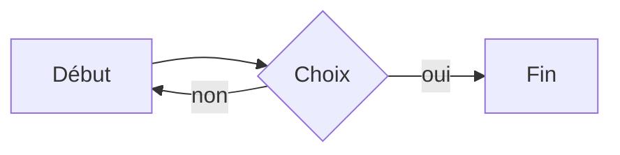

# Titre de niveau 1

Un paragraphe avec du **gras**, de l'*italique*, du ~~barré~~, du `code en ligne`, un [lien](https://example.com) et des accents : éàüœ ÉÀ 日本語 🙂.

## Titre de niveau 2

### Titre de niveau 3

#### Titre de niveau 4

##### Titre de niveau 5

###### Titre de niveau 6

---

- Liste à puces
- Deuxième élément
  - Élément imbriqué
    - Encore plus bas

1. Liste numérotée
2. Deuxième élément
   1. Sous-élément

a. Liste lettrée
b. Deuxième lettre

- [ ] Tâche à faire
- [x] Tâche terminée

> Une citation
> sur deux lignes

> [!NOTE]
> Un callout de type note

> [!WARNING]
> Un callout de type avertissement

| Colonne A | Colonne B | Colonne C |
|:----------|:---------:|----------:|
| gauche    | centre    | droite    |
| **gras**  | `code`    | é à ü     |

```php
<?php
function bonjour(string $nom): string {
    return "Bonjour $nom"; // commentaire
}
```

```javascript
const carre = (x) => x * x;
console.log(carre(4));
```

```python
def carre(x):
    return x ** 2
```



Une formule en ligne $E = mc^2$ et un mot <mark>surligné</mark>.

Fin de la note de référence.
